# Physical Computer Portal
## สารบัญ

1. [ใบงาน: Basic LED (หลอดไฟ LED พื้นฐาน)](#1-ใบงาน-basic-led-หลอดไฟ-led-พื้นฐาน)
2. [ใบงาน: Basic LED RGB (หลอดไฟ RGB LED)](#2-ใบงาน-basic-led-rgb-หลอดไฟ-rgb-led)
3. [ใบงาน: 7 Segments Display](#3-ใบงาน-7-segments-display)
4. [ใบงาน: 7 Segments Display 2 ตัว](#4-ใบงาน-7-segments-display-2-ตัว)
5. [ใบงาน: Button PullUP and PullDown](#5-ใบงาน-button-pullup-and-pulldown)
6. [ใบงาน: LED และ Potentiometer ผ่าน MQTT](#6-ใบงาน-led-และ-potentiometer-ผ่าน-mqtt)
   - [6.1 Message Receive LED](#61-message-receive-led)
   - [6.2 Message Sent Potentiometer](#62-message-sent-potentiometer)
7. [ใบงาน: Keypad 4×4 ด้วย Adafruit Keypad](#7-ใบงาน-keypad-44-ด้วย-adafruit-keypad)
8. [ใบงาน: Keypad ส่งข้อมูลผ่าน MQTT](#8-ใบงาน-keypad-ส่งข้อมูลผ่าน-mqtt)
9. [ใบงาน: RGB LED Control ผ่าน MQTT AND Web](#9-ใบงาน-rgb-led-control-ผ่าน-mqtt-and-web)
10. [ใบงาน: Ultrasonic](#10-ใบงาน-ultrasonic)
11. [ใบงาน: Temperature MCP9700](#11-ใบงาน-temperature-mcp9700)
12. [ใบงาน: Temperature Thermistor (TTC05103)](#12-ใบงาน-temperature-thermistor-ttc05103)
T1. [MQTT:Temp+Num->String](#T1.-mqtt--temp--number---string)
T2. [Potentiometer Analog Reading](#t2-potentiometer-analog-reading)
T3. [LCD + Temp](#t3-lcd--temp)
T4. [Keypad_Plus](#t4-keypad-plus-plus)

## 1. ใบงาน: Basic LED (หลอดไฟ LED พื้นฐาน)
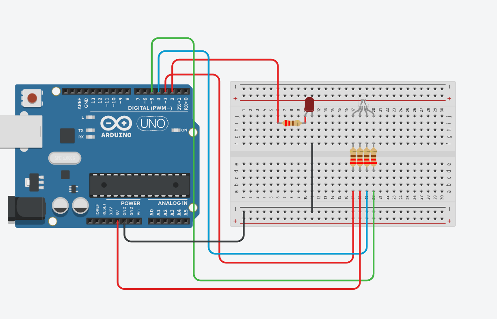

### อุปกรณ์ที่ใช้ (Hardware)
*   **LED** จำนวน 1 หลอด
*   **ตัวต้านทาน (Resistor)** 220 โอห์ม จำนวน 1 ตัว

### โค้ดโปรแกรม (Source Code)

```cpp
int LED_PIN = 6;

void setup() {
  pinMode(LED_PIN, OUTPUT);
}

void loop() {
  for (int i = 0; i < 255; i++) {
    analogWrite(LED_PIN, i);
    delay(10);
  }
}
```

## 2. ใบงาน: Basic LED RGB (หลอดไฟ RGB LED)


### อุปกรณ์ที่ใช้ (Hardware)
*   **LED RGB** จำนวน 1 หลอด
*   **ตัวต้านทาน (Resistor)** 220 โอห์ม จำนวน 4 ตัว

> **ข้อสังเกต (Comment):** โค้ดนี้ใช้กับ LED RGB ประเภท **Common Anode** (ขารวมต่อกับไฟบวก $V_{CC}$) ทำให้การสั่งงานลอจิกเป็นแบบกลับกัน:
> * **LOW (0)** = สั่งให้ไฟติด
> * **HIGH (1)** = สั่งให้ไฟดับ

### โค้ดโปรแกรม (Source Code)

```cpp
int RED_PIN = 3;
int GREEN_PIN = 4;
int BLUE_PIN = 5;

void setup() {
  pinMode(RED_PIN, OUTPUT);
  pinMode(GREEN_PIN, OUTPUT);
  pinMode(BLUE_PIN, OUTPUT);
}

void loop() {
  // ติดสีแดง (Red ON)
  digitalWrite(RED_PIN, LOW);
  digitalWrite(GREEN_PIN, HIGH);
  digitalWrite(BLUE_PIN, HIGH);
  delay(1000);

  // ติดสีเขียว (Green ON)
  digitalWrite(RED_PIN, HIGH);
  digitalWrite(GREEN_PIN, LOW);
  digitalWrite(BLUE_PIN, HIGH);
  delay(1000);

  // ติดสีน้ำเงิน (Blue ON)
  digitalWrite(RED_PIN, HIGH);
  digitalWrite(GREEN_PIN, HIGH);
  digitalWrite(BLUE_PIN, LOW);
  delay(1000);
}
```

## 3. ใบงาน: 7 Segments Display

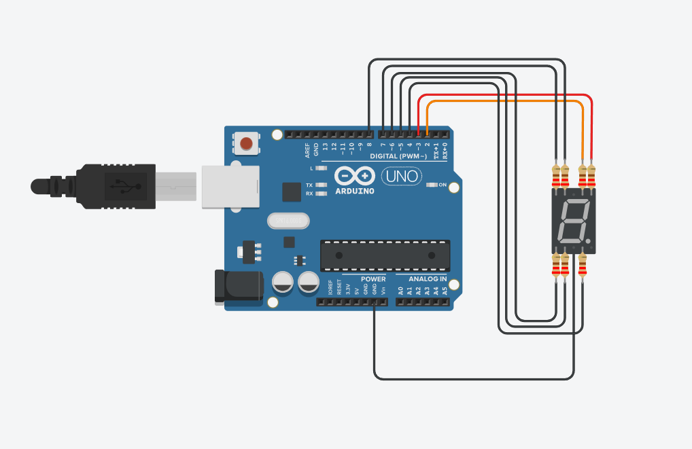

### อุปกรณ์ที่ใช้ (Hardware)
*   **7 Segments Display** จำนวน 1 อัน
*   **ตัวต้านทาน (Resistor)** 220 โอห์ม จำนวน 7 ตัว

> **ข้อสังเกต (Comment):** โค้ดนี้ใช้กับ **7 Segment** ประเภท **Common Cathode** ขารวมต่อกับไฟลบ $Ground$

### โค้ดโปรแกรม (Source Code)

```cpp
const int arr[10][7] = {
  {1,1,1,1,1,1,0},//0
  {0,1,1,0,0,0,0},//1
  {1,1,0,1,1,0,1},//2
  {1,1,1,1,0,0,1},//3
  {0,1,1,0,0,1,1},//4
  {1,0,1,1,0,1,1},//5
  {1,0,1,1,1,1,1},//6
  {1,1,1,0,0,0,0},//7
  {1,1,1,1,1,1,1},//8
  {1,1,1,1,0,1,1}//9
};

void setup()
{
  pinMode(2, OUTPUT);
  pinMode(3, OUTPUT);
  pinMode(4, OUTPUT);
  pinMode(5, OUTPUT);
  pinMode(6, OUTPUT);
  pinMode(7, OUTPUT);
  pinMode(8, OUTPUT);
  pinMode(11,OUTPUT);
  pinMode(12,OUTPUT);
}
void showNumber(int a){
  for (int j=0; j< 7; j++){
    digitalWrite(j+2, arr[a][j]);
  }
}

void loop()
{
  for(int i = 0; i < 10; i++){
    showNumber(i);
    delay(1000);
  }
}
```


## 4. ใบงาน: 7 Segments Display 2 ตัว

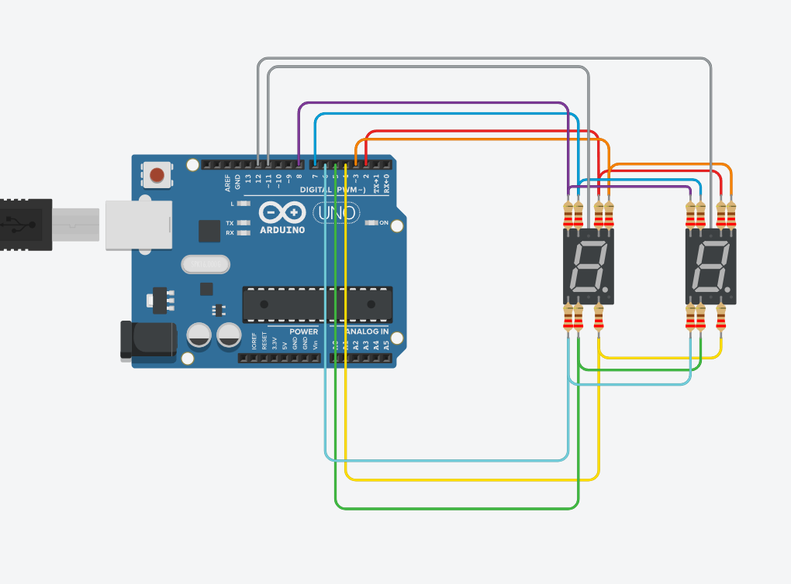

### อุปกรณ์ที่ใช้ (Hardware)
*   **7 Segments Display** จำนวน 2 อัน
*   **ตัวต้านทาน (Resistor)** 220 โอห์ม จำนวน 7 ตัว

> **ข้อสังเกต (Comment):** โค้ดนี้ใช้กับ **7 Segment** ประเภท **Common Cathode** ขารวมต่อกับไฟลบ $Ground$

### โค้ดโปรแกรม (Source Code)

```cpp
const int arr[10][7] = {
  {1,1,1,1,1,1,0},//0
  {0,1,1,0,0,0,0},//1
  {1,1,0,1,1,0,1},//2
  {1,1,1,1,0,0,1},//3
  {0,1,1,0,0,1,1},//4
  {1,0,1,1,0,1,1},//5
  {1,0,1,1,1,1,1},//6
  {1,1,1,0,0,0,0},//7
  {1,1,1,1,1,1,1},//8
  {1,1,1,1,0,1,1}//9
};

void setup()
{
  pinMode(2, OUTPUT);
  pinMode(3, OUTPUT);
  pinMode(4, OUTPUT);
  pinMode(5, OUTPUT);
  pinMode(6, OUTPUT);
  pinMode(7, OUTPUT);
  pinMode(8, OUTPUT);
  pinMode(11,OUTPUT);
  pinMode(12,OUTPUT);
}
void showNumber(int a){
  for (int j=0; j< 7; j++){
    digitalWrite(j+2, arr[a][j]);
  }
}

void loop()
{
  int numarr[8] = {6,8,0,7,0,1,5,3};
  for(int i=0;i < 8; i+=2){
    for (int k = 0; k <10;k++){
      showNumber(numarr[i]);
      digitalWrite(11,HIGH);
      digitalWrite(12,LOW);
      delay(100);
      showNumber(numarr[i+1]);
      digitalWrite(11,LOW);
      digitalWrite(12,HIGH);
      delay(100);
    }
  }
}
```

### ```Tip for 7 Segment```
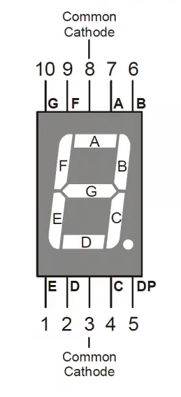

## 5. ใบงาน: Button PullUP and PullDown

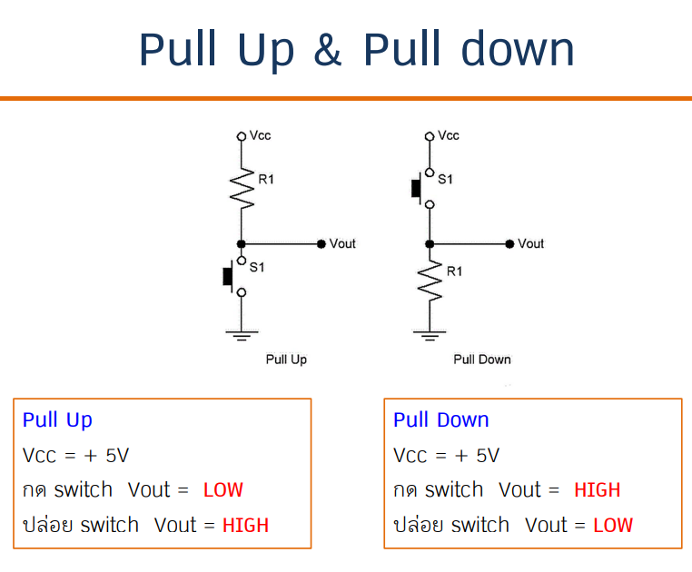

### อุปกรณ์ที่ใช้ (Hardware)
*   **Button** จำนวน 1 อัน
*   **ตัวต้านทาน (Resistor)** 220 โอห์ม จำนวน 1 ตัว

**ข้อสังเกต (Comment):**

> แนะนำให้ดูสไลด์ https://onlearn.it.kmitl.ac.th/pluginfile.php/78276/mod_resource/content/1/PC69-13_Micro02.pdf

> ปุ่มเป็นประเภท **PULL_UP** เมื่อปล่อย State = 1 เมื่อกด State = 0

> ปุ่มเป็นประเภท **PULL_DOWN** เมื่อปล่อย State = 0 เมื่อกด State = 1

### โค้ดโปรแกรม PULL_UP (Source Code) 

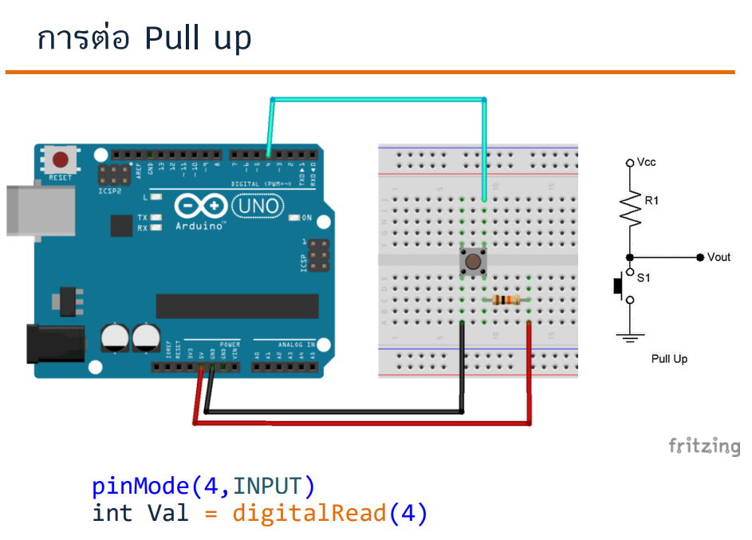

```cpp
void setup() {
  pinMode(5,INPUT_PULLUP);
  Serial.begin(9600);
}

void loop() {
  int data = digitalRead(5);
  Serial.println(data);
  delay(100);
}
```

### โค้ดโปรแกรม PULL_DOWN (Source Code)

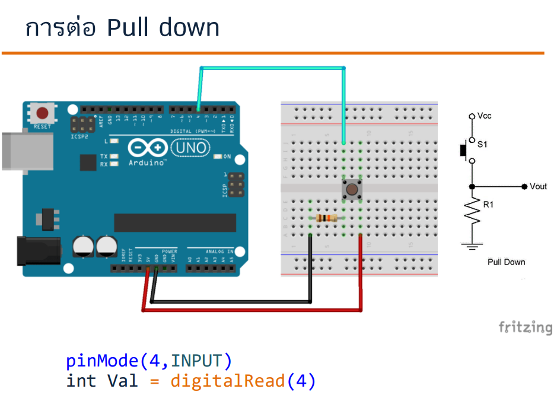

```cpp
void setup() {
  pinMode(5,INPUT);
  Serial.begin(9600);
}

void loop() {
  int data = digitalRead(5);
  Serial.println(data);
  delay(100);
}
```
## 6. ใบงาน: LED และ Potentiometer ผ่าน MQTT


### 6.1 Message Receive LED

#### อุปกรณ์ที่ใช้ (Hardware)

- Arduino UNO R4 WiFi จำนวน 1 บอร์ด
- LED จำนวน 1 หลอด
- ตัวต้านทานสำหรับ LED
- อุปกรณ์หรือโปรแกรมที่ส่งค่าความสว่างผ่าน MQTT

#### ข้อสังเกต (Comment)

- โปรแกรม subscribe MQTT Topic เพื่อรับค่าจากภายนอก แล้วแปลงค่าช่วง 0–1023 เป็นช่วง 0–255 เพื่อควบคุมความสว่าง LED
- เปลี่ยนค่า `WIFI_SSID` และ `WIFI_PASSWORD` ให้ตรงกับเครือข่ายที่ใช้งาน และตรวจสอบ Topic ให้ตรงกับฝั่งส่งข้อมูล

#### โค้ดโปรแกรม (Source Code)

``` cpp
#include <WiFiS3.h>
#include <MQTTClient.h>

int LED_PIN = 6;

const char WIFI_SSID[] = "WIFI_SSID";    // CHANGE TO YOUR WIFI SSID
const char WIFI_PASSWORD[] = "WIFI_PASSWORD";  // CHANGE TO YOUR WIFI PASSWORD
const char MQTT_BROKER_ADRRESS[] = "mqtt-dashboard.com";  // CHANGE TO MQTT BROKER'S ADDRESS
//const char MQTT_BROKER_ADRRESS[] = "192.168.0.11";  // CHANGE TO MQTT BROKER'S IP ADDRESS
const int MQTT_PORT = 1883;
const char MQTT_CLIENT_ID[] = "yossawat_arduino";  // CHANGE IT AS YOU DESIRE
const char MQTT_USERNAME[] = "";                   // CHANGE IT IF REQUIRED, empty if not required
const char MQTT_PASSWORD[] = "";                   // CHANGE IT IF REQUIRED, empty if not required
// The MQTT topics that Arduino should publish/subscribe
const char PUBLISH_TOPIC[] = "yossawat_arduino/send";       // CHANGE IT AS YOU DESIRE
const char SUBSCRIBE_TOPIC[] = "m/led";  // CHANGE IT AS YOU DESIRE
const char TEMP_TOPIC[] = "yossawat_arduino/temperature";
const char LED_TOPIC[] = "yossawat_arduino/led";
const int PUBLISH_INTERVAL = 5000;  // 5 seconds

WiFiClient network;

MQTTClient mqtt = MQTTClient(256);

unsigned long lastPublishTime = 0;

void setup() {
  Serial.begin(9600);
  int status = WL_IDLE_STATUS;
  while (status != WL_CONNECTED) {
    Serial.print("Arduino UNO R4 - Attempting to connect to SSID: ");
    Serial.println(WIFI_SSID);
    // Connect to WPA/WPA2 network. Change this line if using open or WEP network:
    status = WiFi.begin(WIFI_SSID, WIFI_PASSWORD);
    // wait 10 seconds for connection:
    delay(10000);
  }
  // print your board's IP address:
  Serial.print("IP Address: ");
  Serial.println(WiFi.localIP());
  connectToMQTT();
}

void loop() {
  mqtt.loop();
  if (millis() - lastPublishTime > PUBLISH_INTERVAL) {
    sendToMQTT();
    lastPublishTime = millis();
  }
}

void connectToMQTT() {
  mqtt.begin(MQTT_BROKER_ADRRESS, MQTT_PORT, network);
  mqtt.onMessage(messageReceived);
  Serial.print("Arduino UNO R4 - Connecting to MQTT broker");
  while (!mqtt.connect(MQTT_CLIENT_ID, MQTT_USERNAME, MQTT_PASSWORD)) {
    Serial.print(".");
    delay(100);
  }
  Serial.println();
  if (!mqtt.connected()) {
    Serial.println("Arduino UNO R4 - MQTT broker Timeout!");
    return;
  }
  subscribeTopic(SUBSCRIBE_TOPIC);
  subscribeTopic(LED_TOPIC);
  subscribeTopic(TEMP_TOPIC);
  Serial.println("Arduino UNO R4 - MQTT broker Connected!");
}

void subscribeTopic(const char *topic) {
  if (mqtt.subscribe(topic)) {
    Serial.print("Arduino UNO R4 - Subscribed to the topic: ");
  } else {
    Serial.print("Arduino UNO R4 - Failed to subscribe to the topic: ");
  }
  Serial.println(topic);
}

void sendToMQTT() {
  // int val = millis() / 1000;
  int val = analogRead(A0);
  String val_str = String(val);
  char messageBuffer[10];
  val_str.toCharArray(messageBuffer, 10);
  mqtt.publish(PUBLISH_TOPIC, messageBuffer);
  Serial.println("Arduino UNO R4 - sent to MQTT:");
  Serial.print("- topic: ");
  Serial.println(PUBLISH_TOPIC);
  Serial.print("- payload:");
  Serial.println(messageBuffer);
}

void messageReceived(String &topic, String &payload) {
  Serial.println("Arduino UNO R4 - received from MQTT:");
  Serial.println("- topic: " + topic);
  Serial.println("- payload:");
  int data = (payload.toInt() *255)/1023;
  Serial.println(data);
  analogWrite(LED_PIN, data);
}

```

### 6.2 Message Sent Potentiometer

#### อุปกรณ์ที่ใช้ (Hardware)

- Arduino UNO R4 WiFi จำนวน 1 บอร์ด
- Potentiometer ต่อเข้าขา A0

#### ข้อสังเกต (Comment)

- โปรแกรมอ่านค่าจากขา A0 แล้วส่งค่าผ่าน MQTT Topic ที่กำหนด
- ตั้งค่า Wi-Fi และ Topic ให้ตรงกับอุปกรณ์ฝั่งรับข้อมูล

#### โค้ดโปรแกรม (Source Code)

```cpp
#include <WiFiS3.h>
#include <MQTTClient.h>

int LED_PIN = 6;
const char WIFI_SSID[] = "WIFI_SSID";    // CHANGE TO YOUR WIFI SSID
const char WIFI_PASSWORD[] = "WIFI_PASSWORD";  // CHANGE TO YOUR WIFI PASSWORD
const char MQTT_BROKER_ADRRESS[] = "mqtt-dashboard.com";  // CHANGE TO MQTT BROKER'S ADDRESS
//const char MQTT_BROKER_ADRRESS[] = "192.168.0.11";  // CHANGE TO MQTT BROKER'S IP ADDRESS
const int MQTT_PORT = 1883;
const char MQTT_CLIENT_ID[] = "yossawat_arduino";  // CHANGE IT AS YOU DESIRE
const char MQTT_USERNAME[] = "";                   // CHANGE IT IF REQUIRED, empty if not required
const char MQTT_PASSWORD[] = "";                   // CHANGE IT IF REQUIRED, empty if not required
// The MQTT topics that Arduino should publish/subscribe
const char PUBLISH_TOPIC[] = "m/led";       // CHANGE IT AS YOU DESIRE
const char SUBSCRIBE_TOPIC[] = "yossawat_arduino/receive";  // CHANGE IT AS YOU DESIRE
const char TEMP_TOPIC[] = "yossawat_arduino/temperature";
const char LED_TOPIC[] = "yossawat_arduino/led";
const int PUBLISH_INTERVAL = 100;  // 5 seconds

WiFiClient network;
MQTTClient mqtt = MQTTClient(256);

unsigned long lastPublishTime = 0;

void setup() {
  Serial.begin(9600);
  int status = WL_IDLE_STATUS;
  while (status != WL_CONNECTED) {
    Serial.print("Arduino UNO R4 - Attempting to connect to SSID: ");
    Serial.println(WIFI_SSID);
    // Connect to WPA/WPA2 network. Change this line if using open or WEP network:
    status = WiFi.begin(WIFI_SSID, WIFI_PASSWORD);
    // wait 10 seconds for connection:
    delay(10000);
  }
  // print your board's IP address:
  Serial.print("IP Address: ");
  Serial.println(WiFi.localIP());
  connectToMQTT();
}

void loop() {
  mqtt.loop();
  if (millis() - lastPublishTime > PUBLISH_INTERVAL) {
    sendToMQTT();
    lastPublishTime = millis();
  }
}

void connectToMQTT() {
  mqtt.begin(MQTT_BROKER_ADRRESS, MQTT_PORT, network);
  mqtt.onMessage(messageReceived);
  Serial.print("Arduino UNO R4 - Connecting to MQTT broker");
  while (!mqtt.connect(MQTT_CLIENT_ID, MQTT_USERNAME, MQTT_PASSWORD)) {
    Serial.print(".");
    delay(100);
  }
  Serial.println();
  if (!mqtt.connected()) {
    Serial.println("Arduino UNO R4 - MQTT broker Timeout!");
    return;
  }
  subscribeTopic(SUBSCRIBE_TOPIC);
  subscribeTopic(LED_TOPIC);
  subscribeTopic(TEMP_TOPIC);
  Serial.println("Arduino UNO R4 - MQTT broker Connected!");
}

void subscribeTopic(const char *topic) {
  if (mqtt.subscribe(topic)) {
    Serial.print("Arduino UNO R4 - Subscribed to the topic: ");
  } else {
    Serial.print("Arduino UNO R4 - Failed to subscribe to the topic: ");
  }
  Serial.println(topic);
}


void sendToMQTT() {
  // int val = millis() / 1000;
  int val = analogRead(A0);
  String val_str = String(val);
  char messageBuffer[10];
  val_str.toCharArray(messageBuffer, 10);
  mqtt.publish(PUBLISH_TOPIC, messageBuffer);
  Serial.println("Arduino UNO R4 - sent to MQTT:");
  Serial.print("- topic: ");
  Serial.println(PUBLISH_TOPIC);
  Serial.print("- payload:");
  Serial.println(messageBuffer);
}


void messageReceived(String &topic, String &payload) {
  Serial.println("Arduino UNO R4 - received from MQTT:");
  Serial.println("- topic: " + topic);
  Serial.println("- payload:");
}

```

## 7. ใบงาน: Keypad 4×4 ด้วย Adafruit Keypad


### อุปกรณ์ที่ใช้ (Hardware)

- บอร์ด Arduino ที่รองรับวงจร Keypad จำนวน 1 บอร์ด
- Keypad 4×4 จำนวน 1 ชุด

### ข้อสังเกต (Comment)

- โปรแกรมอ่านปุ่มที่กดและแสดงอักขระผ่าน Serial Monitor
- ติดตั้งไลบรารี `Adafruit_Keypad` ก่อนคอมไพล์โปรแกรม

### โค้ดโปรแกรม (Source Code)

```cpp
#include "Adafruit_Keypad.h"

const byte ROWS = 4;
const byte COLS = 4;

char hexaKeys[ROWS][COLS] = {
  {'1', '2', '3', 'A'},
  {'4', '5', '6', 'B'},
  {'7', '8', '9', 'C'},
  {'*', '0', '#', 'D'}
};

byte rowPins[ROWS] = {9, 8, 7, 6};
byte colPins[COLS] = {5, 4, 3, 2};
Adafruit_Keypad customKeypad = Adafruit_Keypad(makeKeymap(hexaKeys), rowPins, colPins, ROWS, COLS);

void setup() {
  Serial.begin(115200);
  customKeypad.begin();
}

void loop() {
  customKeypad.tick();
  while (customKeypad.available()) {
    keypadEvent e = customKeypad.read();
    if (e.bit.EVENT == KEY_JUST_PRESSED) {
      Serial.print("Pressed: ");
      Serial.println((char)e.bit.KEY);
    }
  }
}

```

## 8. ใบงาน: Keypad ส่งข้อมูลผ่าน MQTT

### อุปกรณ์ที่ใช้ (Hardware)

- Arduino UNO R4 WiFi จำนวน 1 บอร์ด
- Keypad 4×4 จำนวน 1 ชุด
- เครือข่าย Wi-Fi และ MQTT Broker

### ข้อสังเกต (Comment)

- โปรแกรมอ่านปุ่มที่กดจาก Keypad และส่งอักขระไปยัง MQTT Topic ที่กำหนด
- ติดตั้งไลบรารี `Adafruit_Keypad` และ `MQTTClient` ก่อนคอมไพล์
- เปลี่ยนค่า `WIFI_SSID` และ `WIFI_PASSWORD` ให้ตรงกับเครือข่ายที่ใช้งาน

### โค้ดโปรแกรม (Source Code)

```cpp
#include <WiFiS3.h>
#include <MQTTClient.h>
#include "Adafruit_Keypad.h"

const byte ROWS = 4;
const byte COLS = 4;

char hexaKeys[ROWS][COLS] = {
  {'1', '2', '3', 'A'},
  {'4', '5', '6', 'B'},
  {'7', '8', '9', 'C'},
  {'*', '0', '#', 'D'}

};

byte rowPins[ROWS] = {9, 8, 7, 6};
byte colPins[COLS] = {5, 4, 3, 2};

Adafruit_Keypad customKeypad = Adafruit_Keypad(makeKeymap(hexaKeys), rowPins, colPins, ROWS, COLS);

const char WIFI_SSID[] = "WIFI_SSID";    // CHANGE TO YOUR WIFI SSID
const char WIFI_PASSWORD[] = "WIFI_PASSWORD";  // CHANGE TO YOUR WIFI PASSWORD
const char MQTT_BROKER_ADRRESS[] = "mqtt-dashboard.com";  // CHANGE TO MQTT BROKER'S ADDRESS
//const char MQTT_BROKER_ADRRESS[] = "192.168.0.11";  // CHANGE TO MQTT BROKER'S IP ADDRESS
const int MQTT_PORT = 1883;
const char MQTT_CLIENT_ID[] = "yossawat_arduino";  // CHANGE IT AS YOU DESIRE
const char MQTT_USERNAME[] = "";                   // CHANGE IT IF REQUIRED, empty if not required
const char MQTT_PASSWORD[] = "";                   // CHANGE IT IF REQUIRED, empty if not required
// The MQTT topics that Arduino should publish/subscribe
const char PUBLISH_TOPIC[] = "m/keypad";       // CHANGE IT AS YOU DESIRE
const char SUBSCRIBE_TOPIC[] = "yossawat_arduino/receive";  // CHANGE IT AS YOU DESIRE
const char TEMP_TOPIC[] = "yossawat_arduino/temperature";
const char LED_TOPIC[] = "yossawat_arduino/led";
const int PUBLISH_INTERVAL = 100;  // 5 seconds
WiFiClient network;
MQTTClient mqtt = MQTTClient(256);
unsigned long lastPublishTime = 0;

void setup() {

  Serial.begin(9600);
  customKeypad.begin();
  int status = WL_IDLE_STATUS;
  while (status != WL_CONNECTED) {
    Serial.print("Arduino UNO R4 - Attempting to connect to SSID: ");
    Serial.println(WIFI_SSID);
    // Connect to WPA/WPA2 network. Change this line if using open or WEP network:
    status = WiFi.begin(WIFI_SSID, WIFI_PASSWORD);
    // wait 10 seconds for connection:
    delay(10000);
  }
  // print your board's IP address:
  Serial.print("IP Address: ");
  Serial.println(WiFi.localIP());
  connectToMQTT();
}


void loop() {
  customKeypad.tick();
  mqtt.loop();
  if (millis() - lastPublishTime > PUBLISH_INTERVAL) {
    while (customKeypad.available()) {
      keypadEvent e = customKeypad.read();
      if (e.bit.EVENT == KEY_JUST_PRESSED) {
        Serial.print("Pressed: ");
        Serial.println((char)e.bit.KEY);
        sendToMQTT((char)e.bit.KEY);
      }
    }
    lastPublishTime = millis();
  }
  delay(10);
}

void connectToMQTT() {
  mqtt.begin(MQTT_BROKER_ADRRESS, MQTT_PORT, network);
  mqtt.onMessage(messageReceived);
  Serial.print("Arduino UNO R4 - Connecting to MQTT broker");
  while (!mqtt.connect(MQTT_CLIENT_ID, MQTT_USERNAME, MQTT_PASSWORD)) {
    Serial.print(".");
    delay(100);
  }
  Serial.println();
  if (!mqtt.connected()) {
    Serial.println("Arduino UNO R4 - MQTT broker Timeout!");
    return;
  }
  subscribeTopic(SUBSCRIBE_TOPIC);
  subscribeTopic(LED_TOPIC);
  subscribeTopic(TEMP_TOPIC);
  Serial.println("Arduino UNO R4 - MQTT broker Connected!");
}

void subscribeTopic(const char *topic) {
  if (mqtt.subscribe(topic)) {
    Serial.print("Arduino UNO R4 - Subscribed to the topic: ");
  } else {
    Serial.print("Arduino UNO R4 - Failed to subscribe to the topic: ");
  }

  Serial.println(topic);
}

void sendToMQTT(char val) {
  // int val = millis() / 1000;
  // int val = analogRead(A0);
  String val_str = String(val);
  char messageBuffer[10];
  val_str.toCharArray(messageBuffer, 10);
  mqtt.publish(PUBLISH_TOPIC, messageBuffer);
  Serial.println("Arduino UNO R4 - sent to MQTT:");
  Serial.print("- topic: ");
  Serial.println(PUBLISH_TOPIC);
  Serial.print("- payload:");
  Serial.println(messageBuffer);
}


void messageReceived(String &topic, String &payload) {
  Serial.println("Arduino UNO R4 - received from MQTT:");
  Serial.println("- topic: " + topic);
  Serial.println("- payload:");
}

```

## 9. ใบงาน: RGB LED Control ผ่าน MQTT AND Web

### อุปกรณ์ที่ใช้ (Hardware)

- **Arduino UNO R4 WiFi** จำนวน 1 บอร์ด
- **RGB LED** จำนวน 1 หลอด
- **ตัวต้านทาน (Resistor)** จำนวน 3 ตัว
- สาย Jumper สำหรับเชื่อมต่อวงจร

### ข้อสังเกต (Comment)

- โปรแกรมนี้ใช้ MQTT ในการรับและส่งข้อมูลระหว่าง Arduino กับ MQTT Broker
- MQTT Broker ที่ใช้คือ `mqtt-dashboard.com` ผ่าน Port `1883`
- Arduino Subscribe Topic จำนวน 3 Topic ได้แก่ `meen_arduino/receive`, `yossawat_arduino/led` และ `yossawat_arduino/temperature`
- Arduino ส่งข้อมูลไปยัง Topic `yossawat_arduino/send` ทุก ๆ 5 วินาที
- สามารถสั่งเปิดและปิดไฟ RGB LED ผ่าน MQTT ด้วยข้อความดังนี้

| Payload | การทำงาน |
|---|---|
| `r-on` | เปิดไฟสีแดง |
| `r-off` | ปิดไฟสีแดง |
| `g-on` | เปิดไฟสีเขียว |
| `g-off` | ปิดไฟสีเขียว |
| `b-on` | เปิดไฟสีน้ำเงิน |
| `b-off` | ปิดไฟสีน้ำเงิน |

### โค้ดโปรแกรม (Source Code)

```cpp
#include <WiFiS3.h>
#include <MQTTClient.h>

int RED_PIN = 2;
int GREEN_PIN = 3;
int BLUE_PIN = 4;

const char WIFI_SSID[] = "WIFI_SSID";
const char WIFI_PASSWORD[] = "WIFI_PASSWORD";

const char MQTT_BROKER_ADRRESS[] = "mqtt-dashboard.com";
const int MQTT_PORT = 1883;

const char MQTT_CLIENT_ID[] = "yossawat_arduino";
const char MQTT_USERNAME[] = "";
const char MQTT_PASSWORD[] = "";

const char PUBLISH_TOPIC[] = "yossawat_arduino/send";
const char SUBSCRIBE_TOPIC[] = "meen_arduino/receive";
const char TEMP_TOPIC[] = "yossawat_arduino/temperature";
const char LED_TOPIC[] = "yossawat_arduino/led";

const int PUBLISH_INTERVAL = 5000;

WiFiClient network;
MQTTClient mqtt = MQTTClient(256);

unsigned long lastPublishTime = 0;

void setup() {
  Serial.begin(9600);

  pinMode(RED_PIN, OUTPUT);
  pinMode(GREEN_PIN, OUTPUT);
  pinMode(BLUE_PIN, OUTPUT);

  digitalWrite(RED_PIN, !LOW);
  digitalWrite(GREEN_PIN, !LOW);
  digitalWrite(BLUE_PIN, !LOW);

  int status = WL_IDLE_STATUS;

  while (status != WL_CONNECTED) {
    Serial.print("Arduino UNO R4 - Attempting to connect to SSID: ");
    Serial.println(WIFI_SSID);

    status = WiFi.begin(WIFI_SSID, WIFI_PASSWORD);

    delay(10000);
  }

  Serial.print("IP Address: ");
  Serial.println(WiFi.localIP());

  connectToMQTT();
}

void loop() {
  mqtt.loop();

  if (millis() - lastPublishTime > PUBLISH_INTERVAL) {
    sendToMQTT();
    lastPublishTime = millis();
  }
}

void connectToMQTT() {
  mqtt.begin(MQTT_BROKER_ADRRESS, MQTT_PORT, network);

  mqtt.onMessage(messageReceived);

  Serial.print("Arduino UNO R4 - Connecting to MQTT broker");

  while (!mqtt.connect(MQTT_CLIENT_ID, MQTT_USERNAME, MQTT_PASSWORD)) {
    Serial.print(".");
    delay(100);
  }

  Serial.println();

  if (!mqtt.connected()) {
    Serial.println("Arduino UNO R4 - MQTT broker Timeout!");
    return;
  }

  subscribeTopic(SUBSCRIBE_TOPIC);
  subscribeTopic(LED_TOPIC);
  subscribeTopic(TEMP_TOPIC);

  Serial.println("Arduino UNO R4 - MQTT broker Connected!");
}

void subscribeTopic(const char *topic) {
  if (mqtt.subscribe(topic)) {
    Serial.print("Arduino UNO R4 - Subscribed to the topic: ");
  } else {
    Serial.print("Arduino UNO R4 - Failed to subscribe to the topic: ");
  }

  Serial.println(topic);
}

void sendToMQTT() {
  int val = millis() / 1000;
  // int val = analogRead(A0);

  String val_str = String(val);

  char messageBuffer[10];
  val_str.toCharArray(messageBuffer, 10);

  mqtt.publish(PUBLISH_TOPIC, messageBuffer);

  Serial.println("Arduino UNO R4 - sent to MQTT:");
  Serial.print("- topic: ");
  Serial.println(PUBLISH_TOPIC);
  Serial.print("- payload:");
  Serial.println(messageBuffer);
}

void messageReceived(String &topic, String &payload) {
  Serial.println("Arduino UNO R4 - received from MQTT:");
  Serial.println("- topic: " + topic);
  Serial.println("- payload:");
  Serial.println(payload);

  payload.trim();

  if (payload == "r-on") {
    digitalWrite(RED_PIN, !HIGH);
    Serial.println("r-onnn");
  } else if (payload == "r-off") {
    digitalWrite(RED_PIN, !LOW);
  } else if (payload == "g-on") {
    digitalWrite(GREEN_PIN, !HIGH);
  } else if (payload == "g-off") {
    digitalWrite(GREEN_PIN, !LOW);
  } else if (payload == "b-on") {
    digitalWrite(BLUE_PIN, !HIGH);
  } else if (payload == "b-off") {
    digitalWrite(BLUE_PIN, !LOW);
  }
}
```

## 10. ใบงาน: Ultrasonic

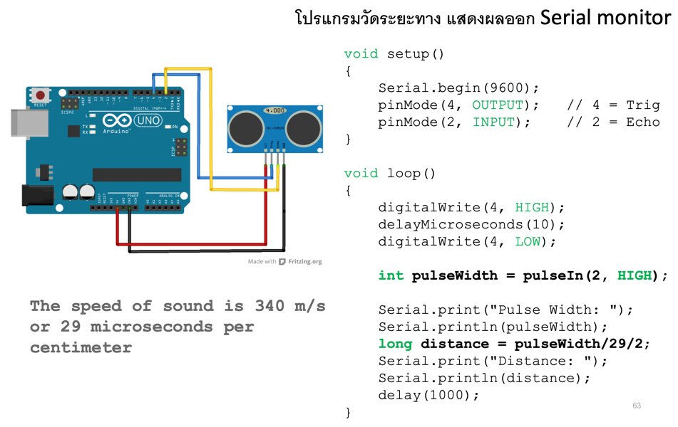

### อุปกรณ์ที่ใช้ (Hardware)

- **Arduino UNO R4 WiFi** จำนวน 1 บอร์ด
- **Ultrasonic Sensor (HC-SR04)** จำนวน 1 ตัว
- สาย Jumper สำหรับเชื่อมต่อวงจร

### ข้อสังเกต (Comment)

- ขา **Trig** ต่อกับขา 10 และขา **Echo** ต่อกับขา 11
- โปรแกรมส่งพัลส์ HIGH ยาว 10 ไมโครวินาทีที่ขา Trig แล้วใช้ `pulseIn()` วัดความกว้างพัลส์ที่ขา Echo
- ระยะทาง (เซนติเมตร) = ความกว้างพัลส์ (ไมโครวินาที) ÷ 58
- ผลลัพธ์แสดงผ่าน Serial Monitor ทุก 1 วินาที

### โค้ดโปรแกรม (Source Code)

```cpp
void setup() {
  Serial.begin(9600);
  pinMode(11, INPUT);
  pinMode(10, OUTPUT);
}

void loop() {
  digitalWrite(10, HIGH);
  delayMicroseconds(10);
  digitalWrite(10, LOW);

  int pulseWidth = pulseIn(11, HIGH);

  Serial.print("Pulse width: ");
  Serial.println(pulseWidth);
  long distance = pulseWidth / 58;
  Serial.print("Distance: ");
  Serial.println(distance);
  delay(1000);
}
```

## 11. ใบงาน: Temperature MCP9700

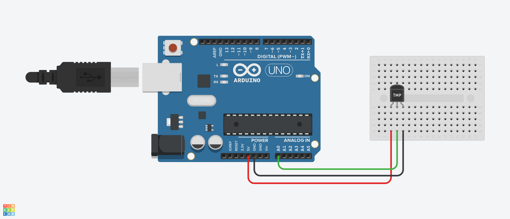

### อุปกรณ์ที่ใช้ (Hardware)

- **Arduino UNO R4 WiFi** จำนวน 1 บอร์ด
- **MCP9700 (Temperature Sensor)** จำนวน 1 ตัว
- สาย Jumper สำหรับเชื่อมต่อวงจร

### ข้อสังเกต (Comment)

- ขา **Vout** ของ MCP9700 ต่อเข้าขา A0 ส่วนขา VDD ต่อ 5V และขา GND ต่อ Ground
- โปรแกรมแปลงค่า ADC (0–1023) เป็นแรงดัน (V) ก่อน
- สูตรคำนวณอุณหภูมิ: $T(°C) = \dfrac{V_{out} - 0.5}{0.01}$ (ออฟเซ็ต 0.5 V ที่ 0°C และความชัน 10 mV/°C)

### โค้ดโปรแกรม (Source Code)

```cpp
void setup() {
  Serial.begin(9600);
}

void loop() {
  int rawADC = analogRead(A0);

  // แปลงค่า ADC (0-1023) เป็นแรงดัน (V)
  float voltage = (rawADC * 5.0) / 1023.0;

  // คำนวณอุณหภูมิสำหรับ MCP9700 (Vout - 0.5V) / 0.01V
  float tempC = (voltage - 0.5) * 100.0;

  Serial.print("Voltage: ");
  Serial.print(voltage, 3);
  Serial.print(" V | Temp: ");
  Serial.print(tempC, 1);
  Serial.println(" °C");

  delay(500);
}
```

## 12. ใบงาน: Temperature Thermistor (TTC05103)


### อุปกรณ์ที่ใช้ (Hardware)

- **Arduino UNO R4 WiFi** จำนวน 1 บอร์ด
- **Thermistor TTC05103 (10k โอห์ม)** จำนวน 1 ตัว
- **ตัวต้านทาน (Resistor)** 10k โอห์ม จำนวน 1 ตัว
- สาย Jumper สำหรับเชื่อมต่อวงจร

### ข้อสังเกต (Comment)

- ต่อวงจรแบ่งแรงดัน: ตัวต้านทาน 10k อยู่ระหว่าง 5V กับ A0 และ Thermistor อยู่ระหว่าง A0 กับ GND
- ถ้าต่อ Thermistor สลับฝั่ง (อยู่ฝั่ง 5V) ให้เปลี่ยนสูตรคำนวณ `r` เป็น `R_FIXED * (ADC_MAX - adc) / adc`
- โปรแกรมอ่านค่า ADC เฉลี่ย 20 ครั้งเพื่อลดสัญญาณรบกวน แล้วคำนวณอุณหภูมิจากสมการ B-parameter
- ค่าพารามิเตอร์: $R_0 = 10k\Omega$ ที่ 25°C ($T_0 = 298.15$ K) และ $B_{25/50} = 4050$ K
- ผลลัพธ์แสดงเป็นองศาเซลเซียส (°C) ผ่าน Serial Monitor

### โค้ดโปรแกรม (Source Code)

```cpp
#include <math.h>

const int   THERMISTOR_PIN = A0;
const float T0       = 298.15;   // 25°C (Kelvin)
const float R0       = 10000.0;  // 10k ที่ 25°C
const float B_VALUE  = 4050.0;   // B25/50
const float R_FIXED  = 10000.0;  // ตัวต้านทานอนุกรม 10k
const float ADC_MAX  = 1023.0;

float readCelsius() {
  long sum = 0;
  for (int i = 0; i < 20; i++) {
    sum += analogRead(THERMISTOR_PIN);
    delay(5);
  }
  float adc = sum / 20.0;

  // Thermistor อยู่ระหว่าง A0 กับ GND
  float r = R_FIXED * adc / (ADC_MAX - adc);

  float kelvin = 1.0 / ((1.0 / T0) + (log(r / R0) / B_VALUE));
  return kelvin - 273.15;
}

void setup() {
  Serial.begin(9600);
}

void loop() {
  Serial.println(readCelsius(), 2);
  delay(500);
}
```

## T1. MQTT + Temp + Number -> String
```cpp
/*
 *
 * This Arduino UNO R4 code is made available for public use without any restriction
 *
 */

#include <WiFiS3.h>
#include <MQTTClient.h>

const char WIFI_SSID[] = "Napon";     // CHANGE TO YOUR WIFI SSID
const char WIFI_PASSWORD[] = "11501112";  // CHANGE TO YOUR WIFI PASSWORD

const char MQTT_BROKER_ADRRESS[] = "mqtt-dashboard.com";  // CHANGE TO MQTT BROKER'S ADDRESS
//const char MQTT_BROKER_ADRRESS[] = "192.168.0.11";  // CHANGE TO MQTT BROKER'S IP ADDRESS
const int MQTT_PORT = 1883;
const char MQTT_CLIENT_ID[] = "arduino-uno-r4-client";  // CHANGE IT AS YOU DESIRE
const char MQTT_USERNAME[] = "";              // CHANGE IT IF REQUIRED, empty if not required
const char MQTT_PASSWORD[] = "";              // CHANGE IT IF REQUIRED, empty if not required

// The MQTT topics that Arduino should publish/subscribe
const char PUBLISH_TOPIC[] = "68070077/temp";       // CHANGE IT AS YOU DESIRE
const char SUBSCRIBE_TOPIC[] = "";  // CHANGE IT AS YOU DESIRE

const int PUBLISH_INTERVAL = 5000;  // 5 seconds


//-------------
const int sensorPin = A0;


WiFiClient network;
MQTTClient mqtt = MQTTClient(256);

unsigned long lastPublishTime = 0;

void setup() {
  Serial.begin(9600);

  int status = WL_IDLE_STATUS;
  while (status != WL_CONNECTED) {
    Serial.print("Arduino UNO R4 - Attempting to connect to SSID: ");
    Serial.println(WIFI_SSID);
    // Connect to WPA/WPA2 network. Change this line if using open or WEP network:
    status = WiFi.begin(WIFI_SSID, WIFI_PASSWORD);

    // wait 10 seconds for connection:
    delay(10000);
  }
  // print your board's IP address:
  Serial.print("IP Address: ");
  Serial.println(WiFi.localIP());

  connectToMQTT();
}

void loop() {
  mqtt.loop();

  if (millis() - lastPublishTime > PUBLISH_INTERVAL) {
    sendToMQTT();
    lastPublishTime = millis();
  }
}

void connectToMQTT() {
  // Connect to the MQTT broker
  mqtt.begin(MQTT_BROKER_ADRRESS, MQTT_PORT, network);

  // Create a handler for incoming messages
  mqtt.onMessage(messageReceived);

  Serial.print("Arduino UNO R4 - Connecting to MQTT broker");

  while (!mqtt.connect(MQTT_CLIENT_ID, MQTT_USERNAME, MQTT_PASSWORD)) {
    Serial.print(".");
    delay(100);
  }
  Serial.println();

  if (!mqtt.connected()) {
    Serial.println("Arduino UNO R4 - MQTT broker Timeout!");
    return;
  }

  // Subscribe to a topic, the incoming messages are processed by messageHandler() function
  if (mqtt.subscribe(SUBSCRIBE_TOPIC))
    Serial.print("Arduino UNO R4 - Subscribed to the topic: ");
  else
    Serial.print("Arduino UNO R4 - Failed to subscribe to the topic: ");

  Serial.println(SUBSCRIBE_TOPIC);
  Serial.println("Arduino UNO R4 - MQTT broker Connected!");
}

void sendToMQTT() {
  int rawValue = analogRead(sensorPin);
  float voltage = ((rawValue * 5.0) / 1023.0);
  float temperatureC = 100 * (voltage - 1) + 38;
  float temperatureF = (temperatureC * 9.0 / 5.0) + 32.0;
  Serial.println(voltage, 3);
  Serial.println(temperatureC, 2);
  Serial.println(temperatureF, 2);
  // int val = millis()/1000;
  // //int val = analogRead(A0);
  String val_str = String(temperatureC);

  char messageBuffer[10];
  val_str.toCharArray(messageBuffer, sizeof(messageBuffer));

  mqtt.publish(PUBLISH_TOPIC, messageBuffer);
  
  Serial.println("Arduino UNO R4 - sent to MQTT:");
  Serial.print("- topic: ");
  Serial.println(PUBLISH_TOPIC);
  Serial.print("- payload:");
  Serial.println(messageBuffer);
}

void messageReceived(String &topic, String &payload) {
  Serial.println("Arduino UNO R4 - received from MQTT:");
  Serial.println("- topic: " + topic);
  Serial.println("- payload:");
  Serial.println(payload);

  // You can process the incoming data , then control something
  /*
  process something
  */
}
```

## T2. Potentiometer Analog Reading


```cpp
const int ledPin = 3;  // Pin for LED (PWM pin)
const int potPin = A0; // Pin for Potentiometer (Analog input pin)

void setup() {
  pinMode(ledPin, OUTPUT); // Set the LED pin as OUTPUT
}

void loop() {
  int potValue = analogRead(potPin); // Read the value from the Potentiometer

  // Scale the potValue directly
  int brightness = potValue / 4; // Scale down from 0-1023 to 0-255
  
  analogWrite(ledPin, brightness); // Write the brightness value to the LED
}
```

## T3. LCD + Temp
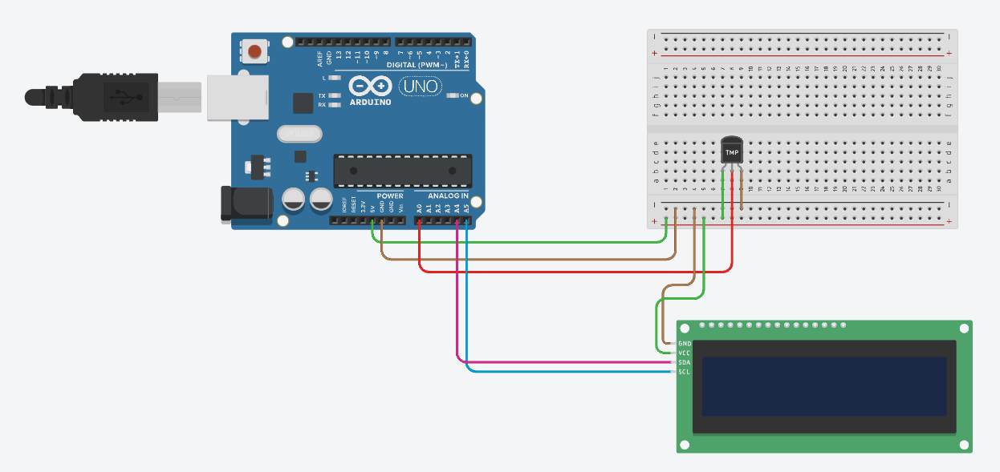

```cpp
#include <LiquidCrystal_I2C.h>
LiquidCrystal_I2C lcd(0x27, 16, 2);

void setup() {
  lcd.init();
  lcd.backlight();
}

void loop() {
  int sensorVal = analogRead(A0);
  
  float voltage = (sensorVal * 5.0) / 1024.0;
  
  float tempC = (voltage - 0.5) * 100.0;
  
  lcd.clear();
  lcd.setCursor(0, 0);
  lcd.print("Temp: ");
  // lcd.setCursor(0, 1); //ขึ้นบรรทัดใหม่ (ลำดับ,บรรทัด)
  lcd.print(tempC, 2);
  // lcd.print(tempC, 0);  // 29
  // lcd.print(tempC, 1);  // 28.6
  // lcd.print(tempC, 2);  // 28.57
  // lcd.print(tempC, 3);  // 28.567
  lcd.print(" C");
  
  delay(1000);
}
```

## T4. Keypad Plus Plus
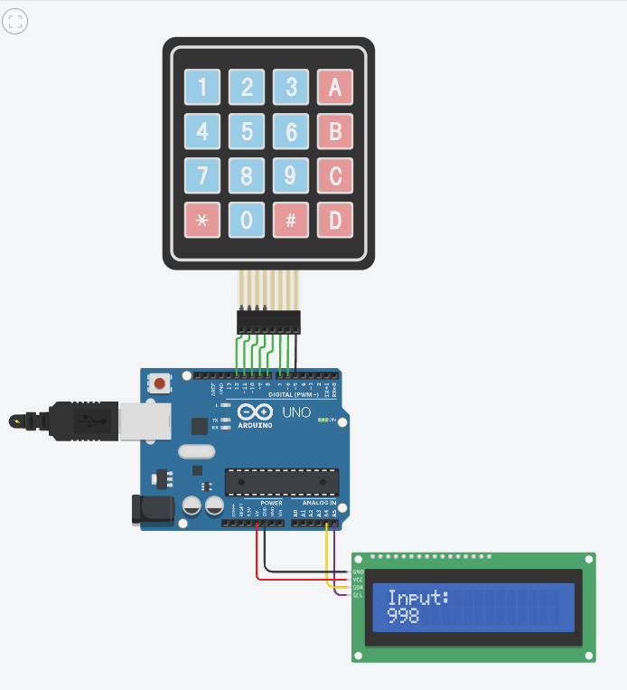

```cpp
#include <LiquidCrystal_I2C.h>
#include <Keypad.h>

LiquidCrystal_I2C lcd(0x27, 16, 2);

const byte ROWS = 4;
const byte COLS = 4;

char hexaKeys[ROWS][COLS] = {
  {'1', '2', '3', 'A'},
  {'4', '5', '6', 'B'},
  {'7', '8', '9', 'C'},
  {'*', '0', '#', 'D'}
};

byte rowPins[ROWS] = {12, 11, 10, 9};
byte colPins[COLS] = {8, 7, 6, 5};

Keypad customKeypad = Keypad(makeKeymap(hexaKeys), rowPins, colPins, ROWS, COLS);

void resetScreen() {
  lcd.clear();
  lcd.setCursor(0, 0);
  lcd.print("Input: ");
  lcd.setCursor(0, 1); // นำเคอร์เซอร์ลงมารอรับตัวอักษรที่บรรทัดที่ 2
}

void setup() {
  lcd.init();
  lcd.backlight();
  resetScreen();
}

void loop() {
  char customKey = customKeypad.getKey();

  if (customKey) {
    if (customKey == '#') {
      resetScreen(); // ถ้ากด # ให้ล้างหน้าจอและตั้งตำแหน่งใหม่
    } else {
      lcd.print(customKey); // ปุ่มอื่น ๆ พิมพ์ลงจอตามปกติ
    }
  }
}
```