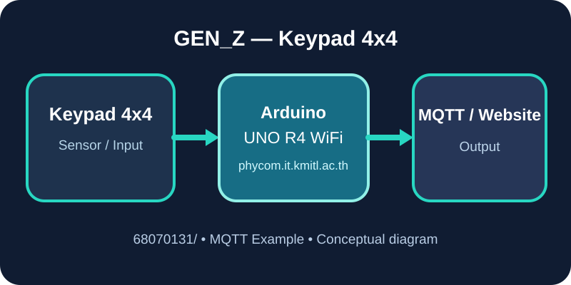
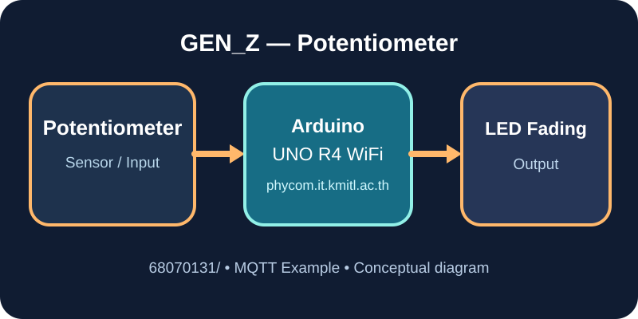
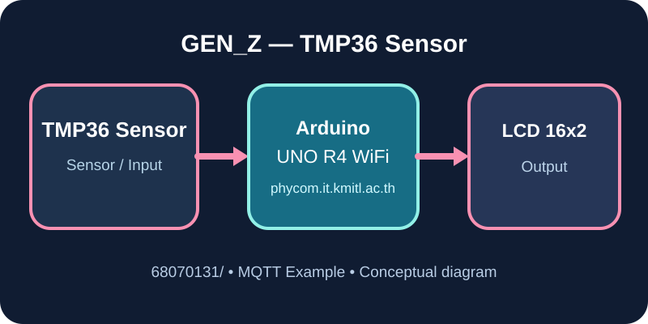
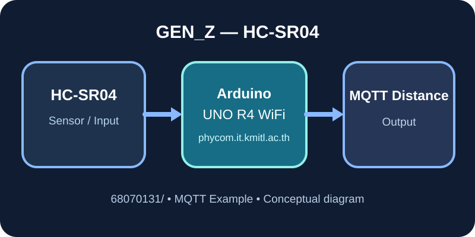

| [🏠 คู่มือ LAB](#menu) | [🔎 ค้นหาโจทย์](https://kmitl68070131.github.io/LAB-Arduino-Phycom/ที่อาจจะออกมั้ง/web/) | [📖 ค้นหาคำสั่งและเซนเซอร์](https://kmitl68070131.github.io/LAB-Arduino-Phycom/ที่อาจจะออกมั้ง/คำสั่งและเซนเซอร์/) | [📚 GitHub พี่เต้](https://github.com/TaeTanakrit0089/PhysicalComputing-167) | [🤝 GitHub เพื่อน](https://github.com/ObeOne-KMITL/lab_iot/blob/main/arduino_R4/mqtt.ino) | [🧩 ประยุกต์ LAB](%E0%B8%9B%E0%B8%A3%E0%B8%B0%E0%B8%A2%E0%B8%B8%E0%B8%81%E0%B8%95%E0%B9%8C%20LAB/) |
|:---:|:---:|:---:|:---:|:---:|:---:|

# 🔌 LAB-Arduino-Phycom

   

**คู่มือ Arduino UNO R4 WiFi สำหรับเรียน Physical Computing** — คำสั่งต่าง ๆ พร้อมหน้าที่ วิธีใช้ การต่อสาย และตัวอย่างโค้ดแยกตามอุปกรณ์

<a id="menu"></a>

## 🌐 เปิด GitHub Pages หากเว็บไซต์ขึ้น 404

ไฟล์เว็บพร้อมเผยแพร่แล้ว แต่ถ้าเปิดลิงก์ `github.io` แล้วขึ้นข้อความ **There isn't a GitHub Pages site here** ให้เข้า [Settings → Pages](https://github.com/Kmitl68070131/LAB-Arduino-Phycom/settings/pages) และตั้งค่าตามนี้:

1. **Source:** `Deploy from a branch`
2. **Branch:** `main`
3. **Folder:** `/(root)`
4. คลิก **Save** แล้วตรวจสถานะ Publish ในหน้า Pages และแท็บ [Actions](https://github.com/Kmitl68070131/LAB-Arduino-Phycom/actions)

ลิงก์หลังเปิดใช้งาน:
- [หน้าแรก](https://kmitl68070131.github.io/LAB-Arduino-Phycom/)
- [ค้นหาโจทย์ LAB และ Mock](https://kmitl68070131.github.io/LAB-Arduino-Phycom/ที่อาจจะออกมั้ง/web/)
- [ค้นหาคำสั่งและเซนเซอร์](https://kmitl68070131.github.io/LAB-Arduino-Phycom/ที่อาจจะออกมั้ง/คำสั่งและเซนเซอร์/)

> GitHub Pages เป็นระบบเผยแพร่เว็บไซต์แบบ Static ไม่ใช่ MQTT TCP Broker; หากต้องการส่งคำสั่ง MQTT ไปที่พอร์ต 1883 ต้องมี Bridge ที่รันอยู่จริงหรือใช้ Broker ที่รองรับ MQTT WebSocket

## 📖 ค้นหาคำสั่ง Arduino และคู่มือเซนเซอร์อย่างละเอียด

[🌐 **เปิดเว็บค้นหาคำสั่งและเซนเซอร์**](https://kmitl68070131.github.io/LAB-Arduino-Phycom/ที่อาจจะออกมั้ง/คำสั่งและเซนเซอร์/) · [📂 ดูฐานคำสั่ง](ที่อาจจะออกมั้ง/คำสั่งและเซนเซอร์/) · [📑 คู่มือการใช้งาน](ที่อาจจะออกมั้ง/คำสั่งและเซนเซอร์/README.md)

พิมพ์ชื่อคำสั่ง เช่น `analogRead`, `pulseIn`, `mqtt.publish`, `lcd.setCursor` หรือเลือกเซนเซอร์แบบ Checkbox เพื่อดูคำอธิบายภาษาไทย **คำสั่งนี้ใช้ทำอะไร ใช้ยังไง ต้องต่อสายไหน ตัวแปรอะไร โค้ดตัวอย่าง และปัญหาที่ควรระวัง** พร้อมลิงก์ไปยัง Sketch เต็มที่มีอยู่ใน Repository

## 🔎 ค้นหาโจทย์ LAB / Mock และเลือกเซนเซอร์แบบติ๊กได้

[🌐 **เปิดเว็บค้นหาโจทย์**](https://kmitl68070131.github.io/LAB-Arduino-Phycom/ที่อาจจะออกมั้ง/web/) · [📂 **โฟลเดอร์ที่อาจจะออกมั้ง**](ที่อาจจะออกมั้ง/) · [📖 **เปิดรายการตัวอย่าง 18 ข้อ**](ที่อาจจะออกมั้ง/README.md)

พิมพ์โจทย์ที่ต้องการ หรือเลือกอุปกรณ์หลายตัว เช่น **Ultrasonic + Switch + LCD** เพื่อค้นหา Sketch พร้อมโค้ด .ino, ผังวงจร, MQTT Topics และผลทดสอบที่คาดหวัง

## 🧩 ประยุกต์ LAB พร้อมภาพวงจรและตรวจ Compile

[📂 เปิดโฟลเดอร์ประยุกต์ LAB](%E0%B8%9B%E0%B8%A3%E0%B8%B0%E0%B8%A2%E0%B8%B8%E0%B8%81%E0%B8%95%E0%B9%8C%20LAB/) · [📖 เลือก 12 LAB × 3 โหมด](%E0%B8%9B%E0%B8%A3%E0%B8%B0%E0%B8%A2%E0%B8%B8%E0%B8%81%E0%B8%95%E0%B9%8C%20LAB/README.md) · [🧪 ผลทดสอบที่คาดหวัง](%E0%B8%9B%E0%B8%A3%E0%B8%B0%E0%B8%A2%E0%B8%B8%E0%B8%81%E0%B8%95%E0%B9%8C%20LAB/ผลทดสอบที่คาดหวัง.md) · [💻 เว็บควบคุม MQTT](%E0%B8%9B%E0%B8%A3%E0%B8%B0%E0%B8%A2%E0%B8%B8%E0%B8%81%E0%B8%95%E0%B9%8C%20LAB/เว็บจำลอง/index.html)

แยก **ส่งข้อมูลขึ้นเว็บ (Publish)**, **รับจากเว็บ (Subscribe)** และ **สองทาง (Both)** เป็น Sketch คนละไฟล์ พร้อมภาพผังต่อสาย SVG และ CI ตรวจ Compile (ไม่แก้ไฟล์ LAB เดิม)

## 🧭 เมนูลัด — เลือกหมวดที่ต้องการ

[🌡 **เซนเซอร์และปุ่มกด**](#nav-sensors) | [🧪 **งาน Lab ในสไลด์**](#nav-slides) | [📡 **MQTT และเว็บ**](#nav-mqtt) | [📊 **สถิติ / Array / List**](#nav-data) | [📂 **ไฟล์ Lab และเอกสารสอบ**](#nav-files) | [📖 **คู่มือคำสั่ง**](#nav-reference)

> เลือกหมวดด้านบนเพื่อไปยังตารางไฟล์ แล้วกด **วิธีต่อสาย**, **โค้ด Arduino** หรือ **เปิดโฟลเดอร์** ได้ทันที ไฟล์ `.ino` เปิดใน Arduino IDE; ไฟล์ `.txt` เปิดแล้วคัดลอกเป็น sketch แยกตามข้อ

<a id="nav-sensors"></a>

### 🌡 เซนเซอร์และปุ่มกด — เลือกตามอุปกรณ์

ตัวอย่างในตารางนี้มี Wi-Fi, รับส่ง JSON ผ่าน MQTT, Serial และ LCD พร้อมคอมเมนต์; อัปโหลดทีละชุด

| อุปกรณ์ / สิ่งที่ต้องการอ่าน | วิธีต่อสายและใช้งาน | โค้ด Arduino | เปิดโฟลเดอร์ |
|---|---|---|---|
| อุณหภูมิ TMP36 | [วิธีต่อสาย](MQTT/TMP36/README.md) | [เปิดโค้ด](MQTT/TMP36/TMP36.ino) | [ไฟล์ทั้งหมด](MQTT/TMP36/) |
| อุณหภูมิ MCP9700 | [วิธีต่อสาย](MQTT/MCP9700/README.md) | [เปิดโค้ด](MQTT/MCP9700/MCP9700.ino) | [ไฟล์ทั้งหมด](MQTT/MCP9700/) |
| อุณหภูมิ LM35 | [วิธีต่อสาย](MQTT/LM35/README.md) | [เปิดโค้ด](MQTT/LM35/LM35.ino) | [ไฟล์ทั้งหมด](MQTT/LM35/) |
| เทอร์มิสเตอร์ TTC05103 + R330 | [วิธีต่อสาย](MQTT/TTC05103/README.md) | [เปิดโค้ด](MQTT/TTC05103/TTC05103.ino) | [ไฟล์ทั้งหมด](MQTT/TTC05103/) |
| เทอร์มิสเตอร์ NTC + R10k | [วิธีต่อสาย](MQTT/NTC/README.md) | [เปิดโค้ด](MQTT/NTC/NTC.ino) | [ไฟล์ทั้งหมด](MQTT/NTC/) |
| ตัวต้านทานปรับค่าได้ / ปุ่มหมุน | [วิธีต่อสาย](MQTT/Potentiometer/README.md) | [เปิดโค้ด](MQTT/Potentiometer/Potentiometer.ino) | [ไฟล์ทั้งหมด](MQTT/Potentiometer/) |
| ระดับแสง LDR | [วิธีต่อสาย](MQTT/LDR/README.md) | [เปิดโค้ด](MQTT/LDR/LDR.ino) | [ไฟล์ทั้งหมด](MQTT/LDR/) |
| ระยะห่างอัลตราโซนิก HC-SR04 | [วิธีต่อสาย](MQTT/Ultrasonic/README.md) | [เปิดโค้ด](MQTT/Ultrasonic/Ultrasonic.ino) | [ไฟล์ทั้งหมด](MQTT/Ultrasonic/) |
| ตรวจจับการเคลื่อนไหว PIR | [วิธีต่อสาย](MQTT/PIR/README.md) | [เปิดโค้ด](MQTT/PIR/PIR.ino) | [ไฟล์ทั้งหมด](MQTT/PIR/) |
| ปุ่มกด 2 ขา อ่านสถานะเป็นรอบ | [วิธีต่อสาย](MQTT/Button/README.md) | [เปิดโค้ด](MQTT/Button/Button.ino) | [ไฟล์ทั้งหมด](MQTT/Button/) |
| ปุ่มกด 2 ขา ส่งกด–ปล่อยและจำนวนครั้ง | [วิธีต่อสาย](MQTT/ButtonEvents/README.md) | [เปิดโค้ด](MQTT/ButtonEvents/ButtonEvents.ino) | [ไฟล์ทั้งหมด](MQTT/ButtonEvents/) |
| แป้นกดตัวเลข 4×4 | [วิธีต่อสาย](MQTT/Keypad/README.md) | [เปิดโค้ด](MQTT/Keypad/Keypad.ino) | [ไฟล์ทั้งหมด](MQTT/Keypad/) |
| อุณหภูมิและความชื้น DHT11 | [วิธีต่อสาย](MQTT/DHT11/README.md) | [เปิดโค้ด](MQTT/DHT11/DHT11.ino) | [ไฟล์ทั้งหมด](MQTT/DHT11/) |
| อุณหภูมิและความชื้น DHT22 | [วิธีต่อสาย](MQTT/DHT22/README.md) | [เปิดโค้ด](MQTT/DHT22/DHT22.ino) | [ไฟล์ทั้งหมด](MQTT/DHT22/) |

[⬆ กลับเมนู](#menu)

<a id="nav-slides"></a>

### 🧪 งาน Lab ในสไลด์ — เลือกตามข้อ

[📂 เปิดโฟลเดอร์งานทั้งหมด](GEN_Z/EXERCISES_FROM_SLIDES/) · [📖 วิธีทำและอุปกรณ์แต่ละข้อ](GEN_Z/EXERCISES_FROM_SLIDES/README.md) · [🖼 ดูแกลเลอรีตัวอย่าง](https://kmitl68070131.github.io/LAB-Arduino-Phycom/GEN_Z/WEB/example-gallery.html)

| ข้อ | งาน / อุปกรณ์ | ไฟล์โค้ดจากสไลด์ |
|---|---|---|
| 01 | 7-Segment นับเลข 0–9 | [เปิดไฟล์ข้อ 01](GEN_Z/EXERCISES_FROM_SLIDES/01_7SEG_0to9_Arduino.txt) |
| 02 | 7-Segment แสดงรหัสนักศึกษา | [เปิดไฟล์ข้อ 02](GEN_Z/EXERCISES_FROM_SLIDES/02_7SEG_STUDENT_ID_Arduino.txt) |
| 03 | ปรับความสว่าง LED 4 ดวง | [เปิดไฟล์ข้อ 03](GEN_Z/EXERCISES_FROM_SLIDES/03_LED_FADING_4_Arduino.txt) |
| 04 | Keypad กดเลขแสดง 7-Segment | [เปิดไฟล์ข้อ 04](GEN_Z/EXERCISES_FROM_SLIDES/04_KEYPAD_TO_7SEG_Arduino.txt) |
| 05 | LCD วาดรูปหัวใจด้วยอักษรกำหนดเอง | [เปิดไฟล์ข้อ 05](GEN_Z/EXERCISES_FROM_SLIDES/05_LCD_HEART_Arduino.txt) |
| 06 | TMP36 แสดงอุณหภูมิบน LCD | [เปิดไฟล์ข้อ 06](GEN_Z/EXERCISES_FROM_SLIDES/06_TMP36_LCD_Arduino.txt) |
| 07 | Keypad ส่งปุ่มขึ้นเว็บผ่าน MQTT | [เปิดไฟล์ข้อ 07](GEN_Z/EXERCISES_FROM_SLIDES/07_MQTT_KEYPAD_TX_Arduino.txt) |
| 08 | รับค่าปุ่มผ่าน MQTT เพื่อควบคุม LED | [เปิดไฟล์ข้อ 08](GEN_Z/EXERCISES_FROM_SLIDES/08_MQTT_KEYPAD_RX_Arduino.txt) |
| 09 | ปุ่มหมุนส่งค่า Analog ผ่าน MQTT | [เปิดไฟล์ข้อ 09](GEN_Z/EXERCISES_FROM_SLIDES/09_MQTT_POT_TX_Arduino.txt) |
| 10 | รับค่า MQTT ปรับความสว่าง LED | [เปิดไฟล์ข้อ 10](GEN_Z/EXERCISES_FROM_SLIDES/10_MQTT_LED_FADE_RX_Arduino.txt) |
| 11 | ควบคุมสี RGB จากเว็บ | [เปิดไฟล์ข้อ 11](GEN_Z/EXERCISES_FROM_SLIDES/11_MQTT_RGB_WEB_Arduino.txt) |
| 12 | Ultrasonic ส่งระยะห่างขึ้นเว็บ | [เปิดไฟล์ข้อ 12](GEN_Z/EXERCISES_FROM_SLIDES/12_ULTRASONIC_WEB_Arduino.txt) |

[⬆ กลับเมนู](#menu)

<a id="nav-mqtt"></a>

### 📡 MQTT และเว็บ — เริ่มรับส่งข้อมูล

| ต้องการทำอะไร | เปิดไฟล์หรือโฟลเดอร์ |
|---|---|
| เลือกตัวอย่าง MQTT แยกอุปกรณ์ | [เมนูและขั้นตอนเริ่มใช้งาน](MQTT/README.md) · [โฟลเดอร์ MQTT](MQTT/) |
| ติดตั้งไลบรารี / Topic / JSON / QoS / แก้ปัญหา | [คู่มือไลบรารีและ MQTT](MQTT/LIBRARIES.md) |
| กดปุ่มจริงให้สถานะและจำนวนครั้งขึ้นเว็บ | [วิธีทำปุ่ม 2 ขา](MQTT/ButtonEvents/README.md) · [โค้ด](MQTT/ButtonEvents/ButtonEvents.ino) |
| เปิดเว็บส่งคำสั่งและดูข้อมูลสด | [โฟลเดอร์เว็บ](MQTT/web/) · [หน้าเว็บ](MQTT/web/index.html) · [Node bridge](MQTT/web/server.js) · [Dependencies](MQTT/web/package.json) |
| อ่านตัวอย่างเว็บชุด Lab เดิม | [โฟลเดอร์เว็บ GEN_Z](GEN_Z/WEB/) · [คู่มือสูตรเซนเซอร์](GEN_Z/WEB/library-and-sensors.html) |

เว็บข้อมูลสดใช้ `npm ci` แล้ว `npm start` ใน `MQTT/web` ก่อนเปิด http://127.0.0.1:3000; การเปิด source HTML บน GitHub อย่างเดียวไม่ได้รัน bridge

[⬆ กลับเมนู](#menu)

<a id="nav-data"></a>

### 📊 สถิติ / อาร์เรย์ / ลิสต์ — เลือกเซนเซอร์

[📖 คู่มือสถิติทุกเซนเซอร์](กันเหลี่ยม/README.md) · [📂 โฟลเดอร์สถิติ](กันเหลี่ยม/) · [📖 คู่มืออาร์เรย์และลิสต์](อาร์เรย์และลิสต์/README.md) · [📂 โฟลเดอร์อาร์เรย์และลิสต์](อาร์เรย์และลิสต์/)

| อุปกรณ์ | ต่ำสุด / สูงสุด / เฉลี่ย / มัธยฐาน / ส่วนเบี่ยงเบนมาตรฐาน | เก็บประวัติ Array และ Linked List + LCD + เว็บ |
|---|---|---|
| อุณหภูมิ TMP36 | [เปิดตัวอย่าง](กันเหลี่ยม/TMP36/README.md) | [เปิดตัวอย่าง](อาร์เรย์และลิสต์/TMP36/README.md) |
| อุณหภูมิ MCP9700 | [เปิดตัวอย่าง](กันเหลี่ยม/MCP9700/README.md) | [เปิดตัวอย่าง](อาร์เรย์และลิสต์/MCP9700/README.md) |
| อุณหภูมิ LM35 | [เปิดตัวอย่าง](กันเหลี่ยม/LM35/README.md) | [เปิดตัวอย่าง](อาร์เรย์และลิสต์/LM35/README.md) |
| เทอร์มิสเตอร์ TTC05103 + R330 | [เปิดตัวอย่าง](กันเหลี่ยม/TTC05103/README.md) | [เปิดตัวอย่าง](อาร์เรย์และลิสต์/TTC05103/README.md) |
| เทอร์มิสเตอร์ NTC + R10k | [เปิดตัวอย่าง](กันเหลี่ยม/NTC/README.md) | [เปิดตัวอย่าง](อาร์เรย์และลิสต์/NTC/README.md) |
| ตัวต้านทานปรับค่าได้ / ปุ่มหมุน | [เปิดตัวอย่าง](กันเหลี่ยม/Potentiometer/README.md) | [เปิดตัวอย่าง](อาร์เรย์และลิสต์/Potentiometer/README.md) |
| ระดับแสง LDR | [เปิดตัวอย่าง](กันเหลี่ยม/LDR/README.md) | [เปิดตัวอย่าง](อาร์เรย์และลิสต์/LDR/README.md) |
| ระยะห่างอัลตราโซนิก HC-SR04 | [เปิดตัวอย่าง](กันเหลี่ยม/Ultrasonic/README.md) | [เปิดตัวอย่าง](อาร์เรย์และลิสต์/Ultrasonic/README.md) |
| ตรวจจับการเคลื่อนไหว PIR | [เปิดตัวอย่าง](กันเหลี่ยม/PIR/README.md) | [เปิดตัวอย่าง](อาร์เรย์และลิสต์/PIR/README.md) |
| ปุ่มกด 2 ขา อ่านสถานะเป็นรอบ | [เปิดตัวอย่าง](กันเหลี่ยม/Button/README.md) | [เปิดตัวอย่าง](อาร์เรย์และลิสต์/Button/README.md) |
| ปุ่มกด 2 ขา ส่งกด–ปล่อยและจำนวนครั้ง | [สถิติจากสถานะปุ่ม](กันเหลี่ยม/Button/README.md) | [เปิดตัวอย่าง](อาร์เรย์และลิสต์/ButtonEvents/README.md) |
| แป้นกดตัวเลข 4×4 | [เปิดตัวอย่าง](กันเหลี่ยม/Keypad/README.md) | [เปิดตัวอย่าง](อาร์เรย์และลิสต์/Keypad/README.md) |
| อุณหภูมิและความชื้น DHT11 | [เปิดตัวอย่าง](กันเหลี่ยม/DHT11/README.md) | [เปิดตัวอย่าง](อาร์เรย์และลิสต์/DHT11/README.md) |
| อุณหภูมิและความชื้น DHT22 | [เปิดตัวอย่าง](กันเหลี่ยม/DHT22/README.md) | [เปิดตัวอย่าง](อาร์เรย์และลิสต์/DHT22/README.md) |

[⬆ กลับเมนู](#menu)

<a id="nav-files"></a>

### 📂 ไฟล์ Lab และเอกสารสอบ

| หมวด | เปิดโฟลเดอร์ / เอกสาร |
|---|---|
| ชุดตัวอย่าง GEN_Z | [โฟลเดอร์](GEN_Z/) · [README](GEN_Z/README.md) |
| Lab / เอกสารเตรียมสอบต้นฉบับ | [โฟลเดอร์ Phycom lab EXAM](Phycom%20lab%20EXAM/) |
| สไลด์ PDF สัปดาห์ 12–15 | [สัปดาห์ 12](Phycom%20lab%20EXAM/12.pdf) · [สัปดาห์ 13](Phycom%20lab%20EXAM/13.pdf) · [สัปดาห์ 14](Phycom%20lab%20EXAM/14.pdf) · [สัปดาห์ 15](Phycom%20lab%20EXAM/15.pdf) |
| โค้ดรวมจาก Lab | [ALL.txt](Phycom%20lab%20EXAM/ALL.txt) |
| สรุปคำสั่งภาษาไทย | [Cheat Sheet TXT](Phycom%20lab%20EXAM/Arduino_UNO_R4_Physical_Computing_Cheatsheet_TH.txt) |
| ชุด Noah Ark — ตัวอย่าง Arduino ของ Kt | [โฟลเดอร์ Arduino](Phycom%20lab%20EXAM/Noah_Ark-main/Kt/arduino/) |
| ชุด Noah Ark — ใบงานและตัวอย่าง TrustMeBro | [โฟลเดอร์](Phycom%20lab%20EXAM/Noah_Ark-main/TrustMeBro/) · [คู่มือพื้นฐาน](Phycom%20lab%20EXAM/Noah_Ark-main/TrustMeBro/00_Base.md) |
| ชุดข้อสอบจำลอง Phycom MOCK Test | [โฟลเดอร์](Phycom%20MOCK%20Test%202-1-66/) · [README](Phycom%20MOCK%20Test%202-1-66/README.md) |

<details>
<summary>📄 เปิดไฟล์เซนเซอร์และอุปกรณ์ต้นฉบับรายตัว — คลิกขยาย</summary>

| อุปกรณ์ / งาน | ไฟล์เดิม |
|---|---|
| อุณหภูมิ TMP36 | [TMP.txt](Phycom%20lab%20EXAM/TMP.txt) |
| เทอร์มิสเตอร์ | [thermistor.txt](Phycom%20lab%20EXAM/thermistor.txt) |
| ปุ่มหมุน Potentiometer | [potentiometer.txt](Phycom%20lab%20EXAM/potentiometer.txt) |
| วัดระยะ Ultrasonic | [Ultrasonic.txt](Phycom%20lab%20EXAM/Ultrasonic.txt) |
| Ultrasonic ร่วมกับปุ่มกด | [Ultrasonic + button.txt](Phycom%20lab%20EXAM/Ultrasonic%20%2B%20button.txt) |
| Keypad ส่งค่าเว็บ | [keypad go to web.txt](Phycom%20lab%20EXAM/keypad%20go%20to%20web.txt) |
| RGB LED | [RGB.txt](Phycom%20lab%20EXAM/RGB.txt) |
| 7-Segment | [7-seg.txt](Phycom%20lab%20EXAM/7-seg.txt) |

</details>

[⬆ กลับเมนู](#menu)

<a id="nav-reference"></a>

### 📖 คู่มือคำสั่งและตัวอย่างพื้นฐาน

อ่านเนื้อหาคู่มือเดิมต่อด้านล่างได้เลย หรือใช้สารบัญของ GitHub เลือกหัวข้อ เช่น Serial, LCD, Keypad, เซนเซอร์ และ MQTT

---

## 1. เริ่มต้นใช้งานและสารบัญ

> 📚 คู่มือ **Arduino UNO R4 WiFi + Physical Computing LAB** รวมคำสั่งพื้นฐาน เซนเซอร์ จอ LCD และ MQTT สำหรับทบทวนก่อนสอบ พร้อมตัวอย่างใช้งานจริง

🌐 [เปิดเว็บคู่มือแบบเลือกหัวข้อ](https://kmitl68070131.github.io/LAB-Arduino-Phycom/) · 📁 [ไฟล์ LAB ต้นฉบับ](Phycom%20lab%20EXAM/) · 📄 [Cheat Sheet TXT](Phycom%20lab%20EXAM/Arduino_UNO_R4_Physical_Computing_Cheatsheet_TH.txt)

**วิธีใช้:** เลือกหัวข้อจากสารบัญ GitHub ทางด้านบนของ README, อ่านตารางคำสั่ง, ดูวิธีต่อสาย แล้วคัดลอกโค้ดแต่ละตัวอย่างไปทดสอบ **แยก Sketch** ก่อนนำไปรวมกัน

**สำคัญ:** ตัวอย่างแต่ละหมวดมี `setup()` และ `loop()` ของตนเอง ห้ามนำหลายชุดมาต่อกันโดยตรง ควรรวมเป็น `setup()` เดียวและ `loop()` เดียว ตรวจสอบระดับแรงดัน ชนิดอุปกรณ์ และหมายเลขขาจริงทุกครั้ง

---

## 2. โครงสร้างโปรแกรมและชนิดข้อมูล

| คำสั่ง / ตัวแปร | หน้าที่ |
|---|---|
| `void setup()` | รันหนึ่งครั้งตอนเริ่มหรือรีเซ็ตบอร์ด |
| `void loop()` | วนทำงานซ้ำตลอดเวลา |
| `int` | จำนวนเต็ม เช่น 42 |
| `float / double` | จำนวนทศนิยม |
| `bool` | true / false |
| `char` | ตัวอักษรหนึ่งตัว เช่น 'A' |
| `String` | ข้อความ เช่น "Hello" |
| `byte` | จำนวนเต็ม 8 บิต 0–255 |
| `unsigned long` | ตัวแปรเวลาจาก millis() |
| `const` | ประกาศค่าที่ไม่เปลี่ยน |
| `#define` | สร้างมาโคร/ค่าคงที่ |
| `#include <...>` | นำเข้าไลบรารี |
| `if / else if / else` | เลือกทำงานตามเงื่อนไข |
| `switch / case / break` | เลือกกรณีหลายทาง |
| `for` | วนซ้ำตามจำนวนรอบ |
| `while` | วนซ้ำเมื่อเงื่อนไขเป็นจริง |
| `break / continue / return` | ออกลูป / ข้ามรอบ / ออกจากฟังก์ชัน |
| `== != > < >= <=` | ตัวเปรียบเทียบ |
| `&& / \|\| / !` | AND / OR / NOT |
| `++ / -- / += / -=` | เพิ่มลดหรือสะสมค่า |

```cpp
const int LED_PIN = 13;
void setup() {
  Serial.begin(9600);
  pinMode(LED_PIN, OUTPUT);
}
void loop() {
  digitalWrite(LED_PIN, HIGH);
  delay(500);
  digitalWrite(LED_PIN, LOW);
  delay(500);
}
```

---

## 3. GPIO: Digital / Analog / PWM

| คำสั่ง / ตัวแปร | หน้าที่ |
|---|---|
| `pinMode(9, OUTPUT)` | กำหนด D9 เป็นขาออก |
| `pinMode(4, INPUT)` | กำหนด D4 เป็นขาเข้า |
| `pinMode(4, INPUT_PULLUP)` | เปิดตัวต้านทาน Pull-up ภายใน |
| `digitalWrite(9, HIGH)` | ส่งลอจิก HIGH |
| `digitalWrite(9, LOW)` | ส่งลอจิก LOW |
| `digitalRead(4)` | อ่าน HIGH หรือ LOW |
| `analogRead(A0)` | อ่านค่า ADC จากขา A0 |
| `analogReadResolution(10)` | ADC 10 บิต 0–1023 |
| `analogReadResolution(12)` | ADC 12 บิต 0–4095 |
| `analogWrite(9, 128)` | PWM duty ประมาณ 50% เมื่อความละเอียด 8 บิตและขารองรับ |
| `analogWriteResolution(8)` | ตั้ง PWM 8 บิต |
| `HIGH / LOW` | สถานะดิจิทัล |
| `INPUT / OUTPUT / INPUT_PULLUP` | โหมดขา |

> ⚠️ `analogWrite()` เป็น PWM ไม่ใช่แรงดัน DC คงที่ และต้องใช้ขาที่รองรับ PWM; อย่าต่อ LED โดยไม่มีตัวต้านทานจำกัดกระแส

---

## 4. Serial Monitor และการ Debug

| คำสั่ง / ตัวแปร | หน้าที่ |
|---|---|
| `Serial.begin(9600)` | เปิด Serial 9600 baud |
| `Serial.print(x)` | พิมพ์ไม่ขึ้นบรรทัดใหม่ |
| `Serial.println(x)` | พิมพ์แล้วขึ้นบรรทัดใหม่ |
| `Serial.available()` | จำนวนไบต์ที่รออ่าน |
| `Serial.read()` | อ่านข้อมูลหนึ่งไบต์ |
| `Serial.parseInt()` | อ่านตัวเลขจาก Serial |
| `Serial.flush()` | รอข้อมูลขาออกส่งเสร็จ |
| `Serial.print(x, 2)` | แสดงทศนิยม 2 ตำแหน่ง |
| `Serial.print(x, HEX)` | แสดงฐาน 16 |

```cpp
void setup() { Serial.begin(9600); }
void loop() {
  if (Serial.available() > 0) {
    char c = Serial.read();
    Serial.print("Received: ");
    Serial.println(c);
  }
}
```

หาก Serial เป็นอักขระแปลก ๆ ให้ตั้ง Baud Rate ให้ตรงกับ `Serial.begin(...)`

---

## 5. เวลาและการทำงานแบบไม่บล็อก

| คำสั่ง / ตัวแปร | หน้าที่ |
|---|---|
| `delay(1000)` | หยุดรอ 1 วินาที |
| `delayMicroseconds(10)` | หยุด 10 µs |
| `millis()` | เวลาหลังเปิดเครื่อง หน่วย ms |
| `micros()` | เวลาหลังเปิดเครื่อง หน่วย µs |
| `millis() - last >= interval` | ตรวจว่าครบเวลาหรือยัง โดยไม่ใช้ delay ยาว |

```cpp
unsigned long last = 0;
void setup() { Serial.begin(9600); }
void loop() {
  if (millis() - last >= 1000UL) {
    last = millis();
    Serial.println("1 second");
  }
}
```

เหมาะกับโปรเจกต์ MQTT เพราะต้องเรียก `mqtt.loop()` บ่อย ๆ

---

## 6. LED และ RGB LED

| คำสั่ง / ตัวแปร | หน้าที่ |
|---|---|
| `digitalWrite(LED, HIGH)` | เปิด LED แบบต่อขาไป GND ผ่าน R |
| `digitalWrite(LED, LOW)` | ปิด LED แบบดังกล่าว |
| `analogWrite(PWM_PIN, value)` | ปรับความสว่างด้วย PWM |
| `Common Cathode` | ขารวมต่อ GND; HIGH = ติด |
| `Common Anode` | ขารวมต่อ 5V; LOW = ติด |

**RGB ตามตัวอย่าง LAB:** R → D9, G → D10, B → D11 โดยแต่ละสีมีตัวต้านทาน 220–330Ω แยกกัน

```cpp
const int R=9, G=10, B=11; // Common Anode
void setup() {
  pinMode(R,OUTPUT); pinMode(G,OUTPUT); pinMode(B,OUTPUT);
  digitalWrite(R,HIGH); digitalWrite(G,HIGH); digitalWrite(B,HIGH);
}
void loop() {
  digitalWrite(R,LOW);   // เปิดเฉพาะแดง
  digitalWrite(G,HIGH);  // ปิดเขียว
  digitalWrite(B,HIGH);  // ปิดน้ำเงิน
}
```

📄 [ตัวอย่าง RGB ฉบับเต็ม](Phycom%20lab%20EXAM/RGB.txt)

---

## 7. Button, Switch และ PIR

| คำสั่ง / ตัวแปร | หน้าที่ |
|---|---|
| `pinMode(BUTTON, INPUT_PULLUP)` | ตั้งปุ่มแบบต่อไป GND |
| `digitalRead(BUTTON) == LOW` | ปุ่มถูกกด |
| `digitalRead(BUTTON) == HIGH` | ปุ่มไม่ถูกกด |
| `digitalRead(PIR_PIN)` | อ่านการตรวจจับจาก PIR |
| `millis() / debounce` | กรองการเด้งของหน้าสัมผัสปุ่ม |

**การต่อ:** ปุ่มระหว่าง D4 กับ GND (ใช้ `INPUT_PULLUP`)

```cpp
const byte BUTTON=4;
void setup() { Serial.begin(9600); pinMode(BUTTON,INPUT_PULLUP); }
void loop() {
  Serial.println(digitalRead(BUTTON)==LOW ? "PRESSED" : "RELEASED");
  delay(200);
}
```

PIR: VCC/GND ตามโมดูล, OUT → D2; บางรุ่นต้องรอ Warm-up ก่อนอ่าน

---

## 8. Potentiometer และ LDR

| คำสั่ง / ตัวแปร | หน้าที่ |
|---|---|
| `analogRead(A0)` | อ่านแรงดันจากขากลาง Potentiometer |
| `map(raw,0,1023,0,100)` | แปลงค่า ADC เป็นเปอร์เซ็นต์ |
| `constrain(x,0,100)` | บังคับให้อยู่ช่วง 0–100 |
| `analogReadResolution(10)` | ตั้ง ADC 10 บิต |
| `analogReadResolution(12)` | ตั้ง ADC 12 บิต |

**Potentiometer:** ขานอกสองขาต่อ 5V และ GND; ขากลางต่อ A0

```cpp
void setup() { Serial.begin(9600); analogReadResolution(10); }
void loop() {
  int raw=analogRead(A0);
  int percent=map(raw,0,1023,0,100);
  Serial.println(percent);
  delay(200);
}
```

**LDR:** ต้องต่อร่วมกับตัวต้านทานเป็นวงจรแบ่งแรงดัน; ค่า ADC จะเพิ่มหรือลดตามตำแหน่ง LDR ในวงจร

📄 [ตัวอย่าง Potentiometer ฉบับเต็ม](Phycom%20lab%20EXAM/potentiometer.txt)

---

## 9. Ultrasonic HC-SR04

| คำสั่ง / ตัวแปร | หน้าที่ |
|---|---|
| `digitalWrite(TRIG, LOW)` | เตรียมขา Trigger |
| `delayMicroseconds(2)` | รอให้สัญญาณนิ่ง |
| `digitalWrite(TRIG, HIGH)` | เริ่ม Trigger |
| `delayMicroseconds(10)` | ส่ง Trigger 10 µs |
| `pulseIn(ECHO,HIGH,30000UL)` | วัดระยะเวลาพัลส์ ECHO พร้อม Timeout |
| `duration * 0.0343 / 2.0` | คำนวณระยะทางเป็นเซนติเมตร |

**การต่อ:** VCC → 5V, GND → GND, TRIG → D2, ECHO → D3

```cpp
const byte TRIG=2,ECHO=3;
void setup() { Serial.begin(9600); pinMode(TRIG,OUTPUT); pinMode(ECHO,INPUT); }
void loop() {
  digitalWrite(TRIG,LOW); delayMicroseconds(2);
  digitalWrite(TRIG,HIGH); delayMicroseconds(10);
  digitalWrite(TRIG,LOW);
  unsigned long duration=pulseIn(ECHO,HIGH,30000UL);
  if (duration==0) Serial.println("NO ECHO");
  else Serial.println(duration*0.0343/2.0);
  delay(100);
}
```

ถ้าขึ้น `NO ECHO` ให้ตรวจ TRIG/ECHO, ระยะวัตถุ, GND และไฟเลี้ยง; ตรวจสเปกแรงดัน ECHO ของบอร์ดและโมดูลก่อนต่อ

📄 [Ultrasonic](Phycom%20lab%20EXAM/Ultrasonic.txt) · [Ultrasonic + Button](Phycom%20lab%20EXAM/Ultrasonic%20%2B%20button.txt)

---

## 10. TMP36 Temperature Sensor

| คำสั่ง / ตัวแปร | หน้าที่ |
|---|---|
| `analogRead(A3)` | อ่านแรงดัน Vout |
| `adc * 5.0 / 4095.0` | แปลง ADC 12 บิตเป็นแรงดันเมื่อ Reference = 5V |
| `(voltage - 0.5) * 100` | แปลงแรงดัน TMP36 เป็น °C |
| `analogReadResolution(12)` | ตั้ง ADC 12 บิต |

**การต่อ:** Vs → 5V, Vout → A3, GND → GND **ตรวจขาจริงจาก Datasheet ก่อนเสียบ** เพราะต่อผิดอาจทำให้เซนเซอร์ร้อนหรือเสีย

```cpp
void setup() { Serial.begin(9600); analogReadResolution(12); }
void loop() {
  int adc=analogRead(A3);
  float voltage=adc*(5.0/4095.0);
  float tempC=(voltage-0.5)*100.0;
  Serial.println(tempC);
  delay(1000);
}
```

📄 [ตัวอย่าง TMP ฉบับเต็ม](Phycom%20lab%20EXAM/TMP.txt)

---

## 11. NTC Thermistor

| คำสั่ง / ตัวแปร | หน้าที่ |
|---|---|
| `analogRead(A3)` | อ่านแรงดันจาก Voltage Divider |
| `log(x)` | ลอการิทึมธรรมชาติสำหรับสมการ Beta |
| `R_FIXED * adc / (4095-adc)` | หาความต้านทาน NTC เมื่อวงจร 5V → R_FIXED → A3 → NTC → GND |
| `1 / (1/298.15 + log(R/R0)/BETA)` | คำนวณอุณหภูมิ Kelvin |
| `kelvin - 273.15` | แปลง Kelvin เป็น °C |

**วงจร:** 5V → ตัวต้านทานคงที่ 10kΩ → A3 → NTC 10kΩ → GND (ตัวอย่าง Beta = 4050)

```cpp
#include <math.h>
const float RFIX=10000.0, R0=10000.0, BETA=4050.0;
void setup() { Serial.begin(9600); analogReadResolution(12); }
void loop() {
  int adc=analogRead(A3);
  if(adc>0 && adc<4095) {
    float r=RFIX*adc/(4095.0-adc);
    float c=1.0/(1.0/298.15+log(r/R0)/BETA)-273.15;
    Serial.println(c);
  }
  delay(1000);
}
```

ถ้าตัวต้านทานจริงเป็น **330Ω** ให้แก้ `RFIX=330.0` แต่ความละเอียดช่วงอุณหภูมิห้องมักด้อยกว่าใช้ 10kΩ

📄 [Thermistor ฉบับเต็ม](Phycom%20lab%20EXAM/thermistor.txt)

---

## 12. DHT11 / DHT22

| คำสั่ง / ตัวแปร | หน้าที่ |
|---|---|
| `#include <DHT.h>` | ใช้ไลบรารี DHT |
| `DHT dht(2,DHT11)` | กำหนด DATA ที่ D2 และรุ่น DHT11 |
| `dht.begin()` | เริ่มใช้งานเซนเซอร์ |
| `dht.readTemperature()` | อ่านอุณหภูมิ °C |
| `dht.readHumidity()` | อ่านความชื้น %RH |
| `isnan(value)` | ตรวจสอบค่าอ่านผิดพลาด |

```cpp
#include <DHT.h>
DHT dht(2,DHT11);
void setup() { Serial.begin(9600); dht.begin(); }
void loop() {
  float t=dht.readTemperature();
  float h=dht.readHumidity();
  if(isnan(t)||isnan(h)) Serial.println("DHT ERROR");
  else { Serial.print(t); Serial.print(" C / "); Serial.println(h); }
  delay(2000);
}
```

ต้องติดตั้งไลบรารี DHT ที่เข้ากันได้ และต่อ DATA/VCC/GND ให้ตรงกับรุ่นโมดูล

---

## 13. Keypad 4×4 ไม่ใช้ Keypad.h

| คำสั่ง / ตัวแปร | หน้าที่ |
|---|---|
| `pinMode(ROW, OUTPUT)` | กำหนดสายแถวเป็นขาออก |
| `pinMode(COL, INPUT_PULLUP)` | กำหนดสายคอลัมน์เป็นขาเข้าพร้อม Pull-up |
| `digitalWrite(ROW, LOW)` | เลือกแถวเพื่อสแกน |
| `digitalRead(COL) == LOW` | พบปุ่มที่ถูกกดในแถวนั้น |
| `delayMicroseconds(10)` | รอให้สัญญาณนิ่งก่อนอ่าน |
| `debounce 20–50 ms` | กรองการกดซ้ำจากหน้าสัมผัส |

**ตัวอย่างการต่อ:** R1–R4 → D9,D8,D7,D6; C1–C4 → D5,D4,D3,D2 (ต้องตรวจลำดับสาย Keypad จริง)

```cpp
const byte R[4]={9,8,7,6}, C[4]={5,4,3,2};
const char KEY[4][4]={{'1','2','3','A'},{'4','5','6','B'},{'7','8','9','C'},{'*','0','#','D'}};
char scanKey() {
  for(int r=0;r<4;r++){
    digitalWrite(R[r],LOW); delayMicroseconds(10);
    for(int c=0;c<4;c++){
      if(digitalRead(C[c])==LOW){
        digitalWrite(R[r],HIGH);
        return KEY[r][c];
      }
    }
    digitalWrite(R[r],HIGH);
  }
  return 0;
}
void setup() {
  Serial.begin(9600);
  for(int r=0;r<4;r++){pinMode(R[r],OUTPUT);digitalWrite(R[r],HIGH);}
  for(int c=0;c<4;c++)pinMode(C[c],INPUT_PULLUP);
}
void loop() {
  static char previous=0;
  char current=scanKey();
  if(current && !previous) Serial.println(current);
  previous=current;
  delay(20);
}
```

> ⚠️ หากกดเลขไม่ตรง ให้ตรวจ Row/Column ของแผงจริง ไม่ใช่เปลี่ยนตารางตัวเลขโดยเดาสุ่ม

📄 [Keypad ส่งขึ้นเว็บ MQTT ฉบับเต็ม](Phycom%20lab%20EXAM/keypad%20go%20to%20web.txt)

---

## 14. 7-Segment 1 หลัก

| คำสั่ง / ตัวแปร | หน้าที่ |
|---|---|
| `const byte SEG[7] = {...}` | กำหนดขา A B C D E F G |
| `DIGITS[10][7]` | ตารางรูปแบบเปิด/ปิดแต่ละ Segment |
| `digitalWrite(SEG[i], value)` | สั่ง Segment ติดหรือดับ |
| `Common Cathode` | COM ต่อ GND; HIGH = ติด |
| `Common Anode` | COM ต่อ 5V; LOW = ติด |

**การต่อ:** A–G → D2–D8 ผ่านตัวต้านทานแยกแต่ละ Segment; COM ตามชนิดหลอด

```cpp
const byte SEG[7]={2,3,4,5,6,7,8};
const byte DIGITS[10][7]={
 {1,1,1,1,1,1,0},{0,1,1,0,0,0,0},{1,1,0,1,1,0,1},
 {1,1,1,1,0,0,1},{0,1,1,0,0,1,1},{1,0,1,1,0,1,1},
 {1,0,1,1,1,1,1},{1,1,1,0,0,0,0},{1,1,1,1,1,1,1},
 {1,1,1,1,0,1,1}
};
const bool COMMON_ANODE=false;
void showNumber(int n){
 if(n<0||n>9)return;
 for(int i=0;i<7;i++){
   digitalWrite(SEG[i],COMMON_ANODE ? !DIGITS[n][i] : DIGITS[n][i]);
 }
}
void setup(){for(int i=0;i<7;i++)pinMode(SEG[i],OUTPUT);}
void loop(){for(int n=0;n<10;n++){showNumber(n);delay(1000);}}
```

📄 [7-Segment ฉบับเต็ม](Phycom%20lab%20EXAM/7-seg.txt)

---

## 15. LCD I2C 16×2

| คำสั่ง / ตัวแปร | หน้าที่ |
|---|---|
| `#include <Wire.h>` | ใช้งานบัส I2C |
| `#include <LiquidCrystal_I2C.h>` | ใช้งาน LCD ผ่าน I2C |
| `LiquidCrystal_I2C lcd(0x27,16,2)` | สร้างจอขนาด 16×2 ที่ Address 0x27 |
| `Wire.begin()` | เริ่มบัส I2C |
| `lcd.init()` | เริ่มต้นจอ |
| `lcd.backlight()` | เปิดไฟพื้นหลัง |
| `lcd.noBacklight()` | ปิดไฟพื้นหลัง |
| `lcd.clear()` | ล้างข้อความทั้งหมด |
| `lcd.home()` | กลับตำแหน่งเริ่มต้น |
| `lcd.setCursor(0,1)` | เลือกคอลัมน์ 0 แถว 1 |
| `lcd.print(value)` | แสดงข้อความ/ตัวเลข |
| `lcd.cursor() / lcd.noCursor()` | เปิด/ปิดเคอร์เซอร์ |
| `lcd.blink() / lcd.noBlink()` | เปิด/ปิดการกะพริบเคอร์เซอร์ |

**ต่อสาย:** VCC → 5V, GND → GND, SDA → SDA, SCL → SCL

```cpp
#include <Wire.h>
#include <LiquidCrystal_I2C.h>
LiquidCrystal_I2C lcd(0x27,16,2);
void setup() {
  Wire.begin(); lcd.init(); lcd.backlight(); lcd.clear();
  lcd.setCursor(0,0); lcd.print("Arduino UNO R4");
  lcd.setCursor(0,1); lcd.print("LCD ONLINE");
}
void loop() {}
```

บางโมดูลใช้ Address `0x3F`; หากไฟติดแต่ไม่มีตัวอักษรให้ตรวจ Contrast, I2C Address และสาย SDA/SCL; อย่า `lcd.clear()` ทุก Loop เพราะจอจะกะพริบ

---

## 16. Wi-Fi ด้วย WiFiS3

| คำสั่ง / ตัวแปร | หน้าที่ |
|---|---|
| `#include <WiFiS3.h>` | นำเข้าไลบรารี Wi-Fi สำหรับ UNO R4 WiFi |
| `WiFi.begin(ssid,password)` | เริ่มเชื่อมต่อ Wi-Fi |
| `WiFi.status()` | อ่านสถานะเครือข่าย |
| `WL_CONNECTED` | สถานะเชื่อมต่อสำเร็จ |
| `WiFi.localIP()` | อ่าน IP ของบอร์ด |
| `WiFi.RSSI()` | อ่านระดับสัญญาณ Wi-Fi (dBm) |
| `WiFi.disconnect()` | ตัดการเชื่อมต่อ Wi-Fi |
| `WiFiClient network` | สร้าง TCP Client |

```cpp
#include <WiFiS3.h>
const char SSID[]="YOUR_WIFI", PASS[]="YOUR_PASSWORD";
void setup() {
  Serial.begin(9600);
  WiFi.begin(SSID,PASS);
}
void loop() {
  if(WiFi.status()==WL_CONNECTED) {
    Serial.print("IP: "); Serial.println(WiFi.localIP());
  } else Serial.println("WiFi OFFLINE");
  delay(2000);
}
```

UNO R4 WiFi เชื่อมต่อเครือข่าย Wi-Fi ที่รองรับบอร์ด; อย่าฝังรหัสผ่านจริงใน Repository สาธารณะ

---

## 17. MQTT Publish / Subscribe

| คำสั่ง / ตัวแปร | หน้าที่ |
|---|---|
| `#include <MQTTClient.h>` | ไลบรารี MQTTClient (256dpi) |
| `WiFiClient network` | TCP Transport |
| `MQTTClient mqtt(256)` | สร้าง MQTT Client |
| `mqtt.begin(host,port,network)` | ตั้งค่า Broker |
| `mqtt.connect(clientId)` | เชื่อมต่อ Broker |
| `mqtt.connected()` | ตรวจสถานะ MQTT |
| `mqtt.publish(topic,payload)` | ส่งข้อความไป Topic |
| `mqtt.subscribe(topic)` | รับข้อความจาก Topic |
| `mqtt.onMessage(callback)` | ตั้งฟังก์ชันรับข้อความ |
| `mqtt.loop()` | ประมวลผลแพ็กเก็ต MQTT อย่างต่อเนื่อง |
| `mqtt.disconnect()` | ตัดการเชื่อมต่อ |
| `mqtt.setTimeout(1000)` | กำหนดเวลารอคำตอบเป็น ms |

**Broker ตาม LAB:** `phycom.it.kmitl.ac.th` TCP `1883`

**Topic ตัวอย่าง:** `68070131/temp`, `68070131/light`, `68070131/food`, `68070131/door`, `68070131/venus`, `68070131/prob_stat`, `68070131/keypad`

```cpp
#include <WiFiS3.h>
#include <MQTTClient.h>
WiFiClient network;
MQTTClient mqtt(256);
const char* BROKER="phycom.it.kmitl.ac.th";
void messageReceived(String &topic,String &payload) {
  Serial.print(topic); Serial.print(" => "); Serial.println(payload);
}
void setup() {
  Serial.begin(9600);
  WiFi.begin("YOUR_WIFI","YOUR_PASSWORD");
  while(WiFi.status()!=WL_CONNECTED)delay(200);
  mqtt.begin(BROKER,1883,network);
  mqtt.onMessage(messageReceived);
  if(mqtt.connect("uno-r4-demo-01"))mqtt.subscribe("68070131/venus");
}
void loop() {
  mqtt.loop();
  static unsigned long last=0;
  if(millis()-last>=3000){
    last=millis();
    if(mqtt.connected())mqtt.publish("68070131/temp","25.5");
  }
}
```

**หมายเหตุ:** ตัวอย่างนี้สาธิต API เบื้องต้น หากใช้จริงควรเพิ่มการเชื่อมต่อ Wi-Fi/MQTT ใหม่เมื่อหลุด และ Client ID ต้องไม่ชนกับอุปกรณ์อื่น

📄 [ตัวอย่างโค้ดรวม MQTT และ Sensor](Phycom%20lab%20EXAM/ALL.txt)

---

## 18. คำนวณตัวเลขและ String

| คำสั่ง / ตัวแปร | หน้าที่ |
|---|---|
| `map(x,0,1023,0,100)` | แปลงช่วงจำนวนเต็ม |
| `constrain(x,0,100)` | จำกัดค่าต่ำสุด–สูงสุด |
| `abs(x)` | ค่าสัมบูรณ์ |
| `min(a,b) / max(a,b)` | ค่าต่ำสุด / สูงสุด |
| `sqrt(x)` | รากที่สอง |
| `pow(x,y)` | ยกกำลัง |
| `log(x)` | ลอการิทึมธรรมชาติ |
| `sin(x) / cos(x)` | ฟังก์ชันตรีโกณมิติ (เรเดียน) |
| `String(value)` | แปลงค่าเป็นข้อความ |
| `String(temp,1)` | แปลงทศนิยมเป็นข้อความ 1 ตำแหน่ง |
| `payload.toInt()` | แปลงข้อความเป็นจำนวนเต็ม |
| `payload.toFloat()` | แปลงข้อความเป็นทศนิยม |
| `payload.trim()` | ลบช่องว่างหัวท้าย |
| `payload.length()` | ความยาวข้อความ |
| `payload.substring(a,b)` | ตัดข้อความช่วงที่ต้องการ |
| `payload == "On"` | เปรียบเทียบข้อความ |
| `isnan(value)` | ตรวจว่าค่าไม่ใช่ตัวเลข |

---

## 19. ตาราง Topic ของ LAB

| Topic | ทิศทาง | ข้อมูลตัวอย่าง | การใช้งาน |
|---|---|---|---|
| `68070131/temp` | Publish | `25.5` | ส่งอุณหภูมิ |
| `68070131/light` | Publish | `512` | ส่ง Potentiometer |
| `68070131/food` | Publish | `on` / `off` | ตรวจระยะ Ultrasonic (ตรวจรูปแบบตัวพิมพ์ตามโจทย์) |
| `68070131/door` | Publish | `On` / `Off` | Ultrasonic + Button |
| `68070131/venus` | Subscribe | `28.5` | รับอุณหภูมิแล้วสั่ง RGB |
| `68070131/prob_stat` | Subscribe | `7` | รับเลข 0–9 แสดง 7-Segment |
| `68070131/keypad` | Publish | `5` | ส่งปุ่ม Keypad ขึ้นเว็บ (ตัวอย่างที่กำหนดไว้) |

> Topic และตัวพิมพ์ใหญ่–เล็กของ Payload ต้องตรงกับระบบปลายทางเสมอ

---

## 20. การรวมหลายเซนเซอร์

**หลักการ:** รวม `#include`, กำหนดขาไม่ซ้ำกัน, ใช้ `setup()` เพียงหนึ่งชุด, `loop()` เพียงหนึ่งชุด และแบ่งงานด้วย `millis()` แทน `delay()` ยาว ๆ

```cpp
// ตัวอย่างโครงสร้าง ไม่ใช่ Sketch สมบูรณ์
unsigned long lastSensor=0;
void setup() {
  // Serial.begin(...);
  // pinMode(...);
  // WiFi.begin(...);
  // mqtt.begin(...);
  // lcd.init();
}
void loop() {
  // mqtt.loop();
  // scanKeypad();
  if(millis()-lastSensor>=1000) {
    lastSensor=millis();
    // อ่าน Ultrasonic / TMP36 / Potentiometer
    // อัปเดต LCD เฉพาะข้อความที่เปลี่ยน
    // Publish เมื่อ MQTT connected
  }
}
```

📄 [ALL.txt โค้ดรวมจาก LAB](Phycom%20lab%20EXAM/ALL.txt)

---

## 21. แก้ปัญหาที่พบบ่อย

| อาการ | จุดที่ต้องตรวจ |
|---|---|
| `WiFi.status() != WL_CONNECTED` | SSID/รหัสผ่าน, ความถี่ Wi-Fi, ระยะสัญญาณ |
| MQTT เชื่อมไม่ได้ | Broker, Port, เครือข่าย, Client ID, Firewall |
| MQTT รับข้อมูลไม่ได้ | Subscribe Topic, `mqtt.loop()`, ตัวพิมพ์ใหญ่–เล็ก |
| LCD มีแสงแต่ไม่ขึ้นตัวอักษร | SDA/SCL, I2C 0x27/0x3F, Contrast |
| LCD กะพริบ | หลีกเลี่ยง `lcd.clear()` ทุก Loop |
| Keypad ขึ้นเลขผิด | ลำดับสาย Row/Column, Debounce, การต่อ 7/8 สาย |
| Keypad ส่งเลขซ้ำ | เพิ่ม Debounce และรอปล่อยปุ่มก่อนส่งครั้งต่อไป |
| Ultrasonic ได้ 0 หรือ -1 | TRIG/ECHO, GND, Timeout, ระยะวัตถุ |
| TMP36 ร้อนผิดปกติ | **ตัดไฟทันที** ตรวจขา Vs/Vout/GND ตาม Datasheet |
| Thermistor อ่านเพี้ยน | ค่า R_FIXED, ค่า Beta, ADC Resolution, สูตรวงจร |
| RGB สีสลับ/ติดทุกสี | ตรวจขา R/G/B และชนิด Common Anode/Cathode |
| 7-Segment เลขไม่ตรง | ตรวจ Segment A–G และชนิด COM, ตัวต้านทานแยก |
| Serial เป็นตัวอักษรมั่ว | Baud Rate ต้องตรงกับ `Serial.begin(...)` |
| Compile: library not found | ติดตั้งไลบรารีที่ถูกต้องใน Arduino IDE |
| โปรแกรมค้างเมื่อใช้ MQTT | ลด `delay()`, ตรวจ Timeout และ Reconnect |

### 📁 เอกสารใน Repository
- [Cheat Sheet ภาษาไทย (TXT)](Phycom%20lab%20EXAM/Arduino_UNO_R4_Physical_Computing_Cheatsheet_TH.txt)
- [ALL.txt](Phycom%20lab%20EXAM/ALL.txt)
- [RGB.txt](Phycom%20lab%20EXAM/RGB.txt)
- [7-seg.txt](Phycom%20lab%20EXAM/7-seg.txt)
- [TMP.txt](Phycom%20lab%20EXAM/TMP.txt)
- [Ultrasonic.txt](Phycom%20lab%20EXAM/Ultrasonic.txt)
- [Ultrasonic + button.txt](Phycom%20lab%20EXAM/Ultrasonic%20%2B%20button.txt)
- [potentiometer.txt](Phycom%20lab%20EXAM/potentiometer.txt)
- [thermistor.txt](Phycom%20lab%20EXAM/thermistor.txt)
- [keypad go to web.txt](Phycom%20lab%20EXAM/keypad%20go%20to%20web.txt)

---

**Physical Computing • Arduino UNO R4 WiFi • IT KMITL**

---

## 🧪 ตัวอย่างการใช้โค้ด Arduino + MQTT แบบทำตามได้

> **ตั้งค่ากลาง:** Arduino UNO R4 WiFi, Wi-Fi `EDOK`, Broker `phycom.it.kmitl.ac.th:1883`, Topic ขึ้นต้นด้วย `68070131/`. ติดตั้งไลบรารี **MQTTClient by 256dpi** และใช้ **WiFiS3** ที่มากับแพ็กเกจบอร์ด. ตัวอย่างแต่ละชุดเป็น Sketch แยกกัน

### ตัวอย่าง 1: ปุ่มกดส่ง MQTT ขึ้นเว็บไซต์
**อุปกรณ์:** ปุ่มกด 1 ตัว, Arduino UNO R4 WiFi, สาย Jumper

**ต่อสาย:** ปุ่มด้านหนึ่ง → D4, อีกด้าน → GND (ใช้ `INPUT_PULLUP`, ไม่ต้องเพิ่มตัวต้านทาน Pull-up ภายนอก)

**การทำงาน:** เมื่อกดปุ่มจะส่ง `PRESSED` ไปที่ `68070131/button`; เมื่อปล่อยส่ง `RELEASED` และสามารถดูข้อความบน Dashboard ที่ Subscribe Topic นี้

```cpp
#include <WiFiS3.h>
#include <MQTTClient.h>

const char WIFI_SSID[] = "EDOK";         // ชื่อ Wi-Fi
const char WIFI_PASS[] = "YOUR_PASSWORD";  // รหัส Wi-Fi
const char BROKER[] = "phycom.it.kmitl.ac.th";
const char TOPIC[] = "68070131/button"; // Topic ที่เว็บรับ
WiFiClient network;
MQTTClient mqtt(256);
const int BUTTON_PIN = 4;
int lastState = HIGH;
unsigned long lastTry = 0;

void setup() {
  Serial.begin(115200);
  pinMode(BUTTON_PIN, INPUT_PULLUP);
  WiFi.begin(WIFI_SSID, WIFI_PASS);
  mqtt.begin(BROKER, 1883, network);
}

void loop() {
  if (WiFi.status() != WL_CONNECTED) {
    if (millis() - lastTry > 10000UL) {
      lastTry = millis();
      WiFi.begin(WIFI_SSID, WIFI_PASS);
    }
    return;
  }
  if (!mqtt.connected()) {
    if (millis() - lastTry > 5000UL) {
      lastTry = millis();
      String id = "button-" + String(millis(), HEX);
      mqtt.connect(id.c_str());
    }
    return;
  }
  mqtt.loop();
  int current = digitalRead(BUTTON_PIN);
  if (current != lastState) {
    delay(30); // Debounce
    if (digitalRead(BUTTON_PIN) == current) {
      lastState = current;
      const char* message = current == LOW ? "PRESSED" : "RELEASED";
      mqtt.publish(TOPIC, message);
      Serial.println(message);
    }
  }
}
```

**ทดลอง:** เปิด Serial Monitor ที่ 115200 → กด/ปล่อยปุ่ม → ตรวจข้อความ `PRESSED`/`RELEASED` → เปิดเว็บที่รับ Topic `68070131/button`.

### ตัวอย่าง 2: Potentiometer → MQTT → LED Fading (ทำเป็นคู่)

**ตัวส่ง:** Potentiometer ขานอกต่อ 5V/GND, ขากลางต่อ A0 บอร์ดตัวที่ 1

**ตัวรับ:** LED ขา Anode ต่อ D9 ผ่านตัวต้านทาน 220–330Ω, Cathode ต่อ GND บอร์ดตัวที่ 2

**หลักการ:** ตัวส่งอ่าน Analog 0–1023 และ Publish ที่ `68070131/09_mqtt_pot_tx`; ตัวรับ Subscribe Topic เดียวกันแล้วใช้ `map()` แปลงเป็น PWM 0–255 เพื่อปรับความสว่าง LED

- [เปิดโค้ด Potentiometer ตัวส่ง](GEN_Z/EXERCISES_FROM_SLIDES/09_MQTT_POT_TX_Arduino.txt)
- [เปิดโค้ด LED Fading ตัวรับ](GEN_Z/EXERCISES_FROM_SLIDES/10_MQTT_LED_FADE_RX_Arduino.txt)

**ทดลอง:** อัปโหลดคนละ Sketch ลงบอร์ดสองตัว → หมุน Potentiometer → LED อีกบอร์ดสว่างตามค่า → เว็บรับค่าจาก `68070131/09_mqtt_pot_tx`

### ตัวอย่าง 3: Keypad → MQTT → LED (ทำเป็นคู่)

**ตัวส่ง:** Keypad 4×4 สายแถว R1–R4 ต่อ D9,D8,D7,D6 และคอลัมน์ C1–C4 ต่อ D5,D4,D3,D2 (ตรวจลำดับสายจริง)

**ตัวรับ:** LED ผ่านตัวต้านทานต่อ D13 และ GND

**หลักการ:** กดปุ่ม Keypad → ตัวส่ง Publish ตัวอักษรที่ `68070131/07_mqtt_keypad_tx` → ตัวรับ Subscribe Topic นี้ → กด `1` เปิด LED, ปุ่มอื่นปิด LED

- [เปิดโค้ด Keypad ตัวส่ง](GEN_Z/EXERCISES_FROM_SLIDES/07_MQTT_KEYPAD_TX_Arduino.txt)
- [เปิดโค้ด Keypad ตัวรับ](GEN_Z/EXERCISES_FROM_SLIDES/08_MQTT_KEYPAD_RX_Arduino.txt)

**ทดลอง:** เปิด Serial Monitor ทั้งสองบอร์ด → กดเลข 1 → LED ตัวรับติด → กดเลข 2 → LED ดับ → เว็บแสดงข้อความปุ่มที่กด

### ตัวอย่าง 4: Ultrasonic → MQTT → เว็บ
**อุปกรณ์:** HC-SR04 (VCC→5V, GND→GND, TRIG→D2, ECHO→D3)

```cpp
digitalWrite(TRIG, LOW);
delayMicroseconds(2);
digitalWrite(TRIG, HIGH);
delayMicroseconds(10);
digitalWrite(TRIG, LOW);
unsigned long us = pulseIn(ECHO, HIGH, 30000UL);
float cm = us * 0.0343f / 2.0f;
if (us > 0) mqtt.publish("68070131/12_ultrasonic_web", String(cm, 1));
```

**วิธีใช้:** นำโค้ดส่วนนี้ไปใช้ใน `loop()` หลังเชื่อม MQTT แล้ว โดยกำหนด `TRIG`/`ECHO` และ `pinMode()` ใน `setup()` ก่อน หรือใช้ [Sketch ฉบับเต็ม](GEN_Z/EXERCISES_FROM_SLIDES/12_ULTRASONIC_WEB_Arduino.txt)

### ตัวอย่าง 5: LCD I2C แสดงค่าเซนเซอร์
**ต่อสาย:** LCD VCC→5V, GND→GND, SDA→SDA, SCL→SCL

```cpp
#include <Wire.h>
#include <LiquidCrystal_I2C.h>
LiquidCrystal_I2C lcd(0x27, 16, 2);

void setup() {
  Wire.begin();
  lcd.init();
  lcd.backlight();
  lcd.setCursor(0, 0);
  lcd.print("GEN_Z MQTT");
}
void loop() {
  lcd.setCursor(0, 1);
  lcd.print("READY           ");
}
```

**วิธีใช้:** ติดตั้ง `LiquidCrystal_I2C` → ต่อ LCD → Upload → ตรวจจอ. ถ้าไฟติดแต่ไม่มีตัวอักษรให้ตรวจ Contrast และ Address (อาจเป็น 0x3F)

### วิธีดู MQTT บนเว็บ

- [หน้าแกลเลอรีตัวอย่าง 12 ข้อ พร้อมภาพประกอบ](https://kmitl68070131.github.io/LAB-Arduino-Phycom/GEN_Z/WEB/example-gallery.html)
- [หน้าเว็บ MQTT Exercises](https://kmitl68070131.github.io/LAB-Arduino-Phycom/GEN_Z/WEB/exercises.html)
- [เว็บคู่มือแบบเลือกแท็บ](https://kmitl68070131.github.io/LAB-Arduino-Phycom/)

**สำคัญ:** MQTT Broker ใช้ TCP port 1883 จึงต้องมี Node.js Bridge หรือ MQTT WebSocket endpoint ที่ใช้งานได้จริง; การเปิด HTML ตรงจาก GitHub Pages อย่างเดียวไม่ทำให้ข้อมูล MQTT สดขึ้นอัตโนมัติ

### 🖼️ ภาพประกอบแบบฝึกหัด

[](https://kmitl68070131.github.io/LAB-Arduino-Phycom/GEN_Z/WEB/example-gallery.html)

ภาพในแกลเลอรีเป็น **แผนภาพ SVG เพื่ออธิบายแนวคิด** ไม่ใช่รูปการต่อสายจริง; ให้ตรวจหมายเลขขาและวงจรตามคอมเมนต์ในไฟล์โค้ดก่อนทดลอง


### 🌐 เปิดหน้าเว็บโดยตรง (ไม่ใช่ไฟล์โค้ด GitHub)

- [🏠 เปิดเว็บคู่มือ Arduino](https://kmitl68070131.github.io/LAB-Arduino-Phycom/)
- [🖼️ เปิดแกลเลอรีรูปและตัวอย่าง 12 ข้อ](https://kmitl68070131.github.io/LAB-Arduino-Phycom/GEN_Z/WEB/example-gallery.html)
- [📊 เปิดหน้า MQTT Exercises](https://kmitl68070131.github.io/LAB-Arduino-Phycom/GEN_Z/WEB/exercises.html)

> ถ้าคลิกไฟล์ HTML บน GitHub จะเห็น Source Code; ต้องใช้ลิงก์ github.io ข้างบนเพื่อเปิดเป็นหน้าเว็บ







## 📗 คู่มือ Library และสูตรคำนวณ Sensor (หน้าเว็บ)

**[เปิดหน้าเว็บ Library + Sensor Formulas + MQTT Website Tutorial](https://kmitl68070131.github.io/LAB-Arduino-Phycom/GEN_Z/WEB/library-and-sensors.html)**

มีตารางไลบรารีพร้อมวิธีติดตั้ง สูตร TMP36, LM35, NTC Thermistor, DHT, Ultrasonic, Potentiometer และ LDR พร้อมตัวอย่าง Arduino, Node.js Bridge และ JavaScript สำหรับส่งข้อมูลขึ้นเว็บ ซึ่งใช้ Topic prefix `68070131/` และ Broker `phycom.it.kmitl.ac.th`.
