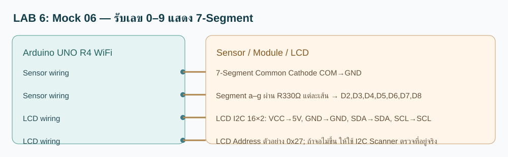

# Mock 06 — รับเลข 0–9 แสดง 7-Segment

**ประเภท:** โจทย์จาก Mock 6 ข้อ · **อุปกรณ์:** 7-Segment + LCD

## วงจร / วิธีต่อสาย

- 7-Segment Common Cathode COM→GND
- Segment a–g ผ่าน R330Ω แต่ละเส้น → D2,D3,D4,D5,D6,D7,D8
- LCD I2C 16×2: VCC→5V, GND→GND, SDA→SDA, SCL→SCL
- LCD Address ตัวอย่าง 0x27; ถ้าจอไม่ขึ้น ให้ใช้ I2C Scanner ตรวจที่อยู่จริง

## ใช้ทำอะไรและทำงานอย่างไร

Mock 06 — รับเลข 0–9 แสดง 7-Segment เชื่อมต่อ Wi-Fi, MQTT และ LCD; เมื่ออ่านข้อมูลได้ Arduino ส่งข้อมูลผ่าน Publish ส่วนคำสั่งจากเว็บเข้าทาง Subscribe ตาม Topic ด้านล่าง แสดงผลบน LCD และตอบกลับ ACK อัตโนมัติ

## จุดแก้ MQTT Topic

- `TOPIC_DATA="68070131/guess/06/data"` : **บอร์ด Publish → เว็บรับ**
- `TOPIC_COMMAND="68070131/prob_stat"` : **เว็บ Publish → บอร์ด Subscribe**
- `TOPIC_ACK="68070131/guess/06/ack"` : **บอร์ดตอบผลคำสั่ง**
- หากเปลี่ยนชื่อ Topic ให้แก้ในไฟล์ `Mock_7Segment.ino` ส่วนที่ 2 และแก้ `catalog.json` / หน้าเว็บให้ตรงกัน

## การทดสอบที่คาดหวัง

เว็บส่ง 7 → 7-Segment และ LCD แสดงเลข 7

คำสั่งตัวอย่าง: `7` ส่งไป `68070131/prob_stat`. เปิด Serial Monitor 115200, เลือก Board Arduino UNO R4 WiFi และตรวจ LCD จะแสดงข้อมูล

**หมายเหตุ:** ข้อมูลนี้เป็นผลคาดหวัง ยังต้องตรวจ Compile และอุปกรณ์จริง; ตัวอย่างอื่นใน Folder เป็น Sketch คนละชุด ห้ามรวมหลาย setup() / loop() เข้าด้วยกัน
