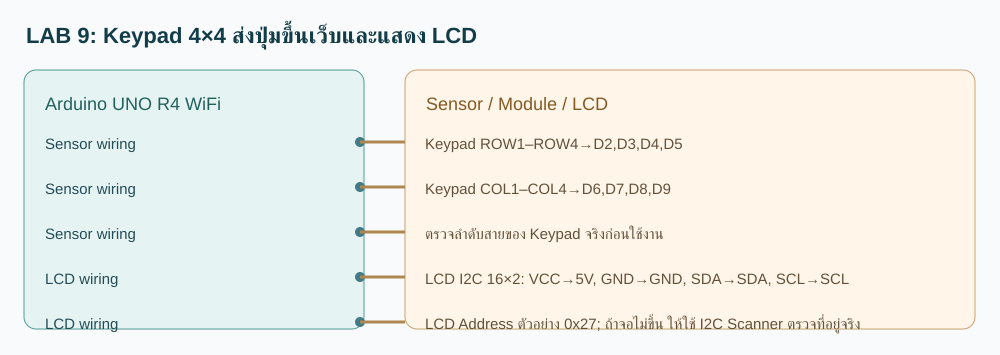

# Keypad 4×4 ส่งปุ่มขึ้นเว็บและแสดง LCD

**ประเภท:** โจทย์คาดการณ์เพื่อฝึกประยุกต์ · **อุปกรณ์:** Keypad + LCD

## วงจร / วิธีต่อสาย

- Keypad ROW1–ROW4→D2,D3,D4,D5
- Keypad COL1–COL4→D6,D7,D8,D9
- ตรวจลำดับสายของ Keypad จริงก่อนใช้งาน
- LCD I2C 16×2: VCC→5V, GND→GND, SDA→SDA, SCL→SCL
- LCD Address ตัวอย่าง 0x27; ถ้าจอไม่ขึ้น ให้ใช้ I2C Scanner ตรวจที่อยู่จริง

## ใช้ทำอะไรและทำงานอย่างไร

Keypad 4×4 ส่งปุ่มขึ้นเว็บและแสดง LCD เชื่อมต่อ Wi-Fi, MQTT และ LCD; เมื่ออ่านข้อมูลได้ Arduino ส่งข้อมูลผ่าน Publish ส่วนคำสั่งจากเว็บเข้าทาง Subscribe ตาม Topic ด้านล่าง แสดงผลบน LCD และตอบกลับ ACK อัตโนมัติ

## จุดแก้ MQTT Topic

- `TOPIC_DATA="68070131/guess/09/data"` : **บอร์ด Publish → เว็บรับ**
- `TOPIC_COMMAND="68070131/guess/09/set"` : **เว็บ Publish → บอร์ด Subscribe**
- `TOPIC_ACK="68070131/guess/09/ack"` : **บอร์ดตอบผลคำสั่ง**
- หากเปลี่ยนชื่อ Topic ให้แก้ในไฟล์ `Keypad_LCD.ino` ส่วนที่ 2 และแก้ `catalog.json` / หน้าเว็บให้ตรงกัน

## การทดสอบที่คาดหวัง

กด A → ส่ง A บน MQTT และ LCD ขึ้น KEY A

คำสั่งตัวอย่าง: `LCD:HELLO` ส่งไป `68070131/guess/09/set`. เปิด Serial Monitor 115200, เลือก Board Arduino UNO R4 WiFi และตรวจ LCD จะแสดงข้อมูล

**หมายเหตุ:** ข้อมูลนี้เป็นผลคาดหวัง ยังต้องตรวจ Compile และอุปกรณ์จริง; ตัวอย่างอื่นใน Folder เป็น Sketch คนละชุด ห้ามรวมหลาย setup() / loop() เข้าด้วยกัน
