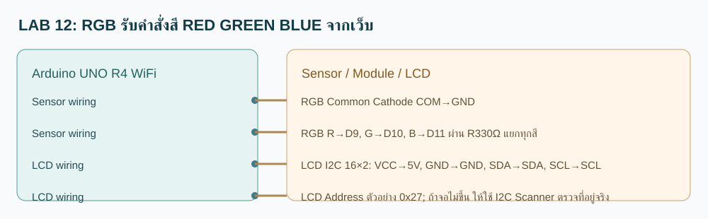

# RGB รับคำสั่งสี RED GREEN BLUE จากเว็บ

**ประเภท:** โจทย์คาดการณ์เพื่อฝึกประยุกต์ · **อุปกรณ์:** RGB + LCD

## วงจร / วิธีต่อสาย

- RGB Common Cathode COM→GND
- RGB R→D9, G→D10, B→D11 ผ่าน R330Ω แยกทุกสี
- LCD I2C 16×2: VCC→5V, GND→GND, SDA→SDA, SCL→SCL
- LCD Address ตัวอย่าง 0x27; ถ้าจอไม่ขึ้น ให้ใช้ I2C Scanner ตรวจที่อยู่จริง

## ใช้ทำอะไรและทำงานอย่างไร

RGB รับคำสั่งสี RED GREEN BLUE จากเว็บ เชื่อมต่อ Wi-Fi, MQTT และ LCD; เมื่ออ่านข้อมูลได้ Arduino ส่งข้อมูลผ่าน Publish ส่วนคำสั่งจากเว็บเข้าทาง Subscribe ตาม Topic ด้านล่าง แสดงผลบน LCD และตอบกลับ ACK อัตโนมัติ

## จุดแก้ MQTT Topic

- `TOPIC_DATA="68070131/guess/12/data"` : **บอร์ด Publish → เว็บรับ**
- `TOPIC_COMMAND="68070131/guess/12/set"` : **เว็บ Publish → บอร์ด Subscribe**
- `TOPIC_ACK="68070131/guess/12/ack"` : **บอร์ดตอบผลคำสั่ง**
- หากเปลี่ยนชื่อ Topic ให้แก้ในไฟล์ `RGB_Web.ino` ส่วนที่ 2 และแก้ `catalog.json` / หน้าเว็บให้ตรงกัน

## การทดสอบที่คาดหวัง

ส่ง RED → D9 HIGH และ D10/D11 LOW

คำสั่งตัวอย่าง: `RED` ส่งไป `68070131/guess/12/set`. เปิด Serial Monitor 115200, เลือก Board Arduino UNO R4 WiFi และตรวจ LCD จะแสดงข้อมูล

**หมายเหตุ:** ข้อมูลนี้เป็นผลคาดหวัง ยังต้องตรวจ Compile และอุปกรณ์จริง; ตัวอย่างอื่นใน Folder เป็น Sketch คนละชุด ห้ามรวมหลาย setup() / loop() เข้าด้วยกัน
