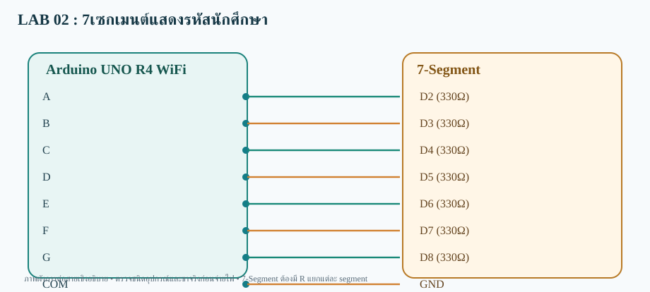

# LAB 02 — 7เซกเมนต์แสดงรหัสนักศึกษา

**ส่งข้อมูลขึ้นเว็บ (Publish)** · Arduino UNO R4 WiFi

## การต่อสาย
- A→D2 (330Ω)
- B→D3 (330Ω)
- C→D4 (330Ω)
- D→D5 (330Ω)
- E→D6 (330Ω)
- F→D7 (330Ω)
- G→D8 (330Ω)
- COM→GND

อุปกรณ์: 7-Segment Common Cathode + ตัวต้านทาน 330Ω จำนวน 7 ตัว

## Topic
- **Publish:**  `68070131/applied/lab02/pub/data`
- **Subscribe:** ไม่ใช้
- **สถานะคำสั่ง:** ไม่ใช้

## วิธีทดสอบ
1. เปิด `SevenSeg_StudentID_pub.ino` ด้วย Arduino IDE (โฟลเดอร์ชื่อเดียวกับ Sketch)
2. เลือก **Arduino UNO R4 WiFi** ติดตั้ง WiFiS3 และ MQTT (256dpi)
3. ต่อสายตามผัง เปิด Serial 115200; ตรวจ Wi-Fi/MQTT
4. อ่านค่า Publish ที่ Topic /data
5. ผลที่คาดหวัง: **เว็บได้รับค่าที่บอร์ดอ่านหรือสร้างขึ้น**

> โค้ดต้องต่อกับ Broker ที่เข้าถึงได้ และต้องตรวจบนบอร์ดจริง ไม่ใช่ยืนยันว่าทดสอบฮาร์ดแวร์แล้ว
