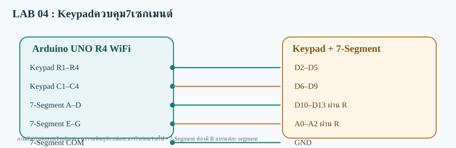

# LAB 04 — Keypadควบคุม7เซกเมนต์

**ส่งข้อมูลขึ้นเว็บ (Publish)** · Arduino UNO R4 WiFi

## การต่อสาย
- Keypad R1–R4→D2–D5
- Keypad C1–C4→D6–D9
- 7-Segment A–D→D10–D13 ผ่าน R
- 7-Segment E–G→A0–A2 ผ่าน R
- 7-Segment COM→GND

อุปกรณ์: Keypad 4×4 + 7-Segment Common Cathode + R 330Ω 7 ตัว

## Topic
- **Publish:**  `68070131/applied/lab04/pub/data`
- **Subscribe:** ไม่ใช้
- **สถานะคำสั่ง:** ไม่ใช้

## วิธีทดสอบ
1. เปิด `Keypad_SevenSeg_pub.ino` ด้วย Arduino IDE (โฟลเดอร์ชื่อเดียวกับ Sketch)
2. เลือก **Arduino UNO R4 WiFi** ติดตั้ง WiFiS3 และ MQTT (256dpi)
3. ต่อสายตามผัง เปิด Serial 115200; ตรวจ Wi-Fi/MQTT
4. อ่านค่า Publish ที่ Topic /data
5. ผลที่คาดหวัง: **เว็บได้รับค่าที่บอร์ดอ่านหรือสร้างขึ้น**

> โค้ดต้องต่อกับ Broker ที่เข้าถึงได้ และต้องตรวจบนบอร์ดจริง ไม่ใช่ยืนยันว่าทดสอบฮาร์ดแวร์แล้ว
