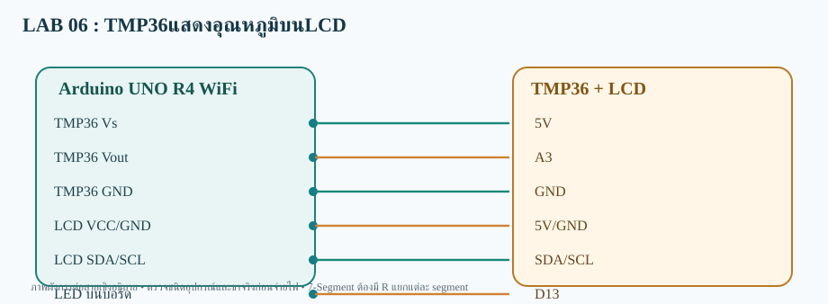

# LAB 06 — TMP36แสดงอุณหภูมิบนLCD

**ส่งข้อมูลขึ้นเว็บ (Publish)** · Arduino UNO R4 WiFi

## การต่อสาย
- TMP36 Vs→5V
- TMP36 Vout→A3
- TMP36 GND→GND
- LCD VCC/GND→5V/GND
- LCD SDA/SCL→SDA/SCL
- LED บนบอร์ด→D13

อุปกรณ์: TMP36 (ตรวจ pinout จาก datasheet) + LCD I2C

## Topic
- **Publish:**  `68070131/applied/lab06/pub/data`
- **Subscribe:** ไม่ใช้
- **สถานะคำสั่ง:** ไม่ใช้

## วิธีทดสอบ
1. เปิด `TMP36_LCD_pub.ino` ด้วย Arduino IDE (โฟลเดอร์ชื่อเดียวกับ Sketch)
2. เลือก **Arduino UNO R4 WiFi** ติดตั้ง WiFiS3 และ MQTT (256dpi) และ LiquidCrystal I2C
3. ต่อสายตามผัง เปิด Serial 115200; ตรวจ Wi-Fi/MQTT
4. อ่านค่า Publish ที่ Topic /data
5. ผลที่คาดหวัง: **เว็บได้รับค่าที่บอร์ดอ่านหรือสร้างขึ้น**

> โค้ดต้องต่อกับ Broker ที่เข้าถึงได้ และต้องตรวจบนบอร์ดจริง ไม่ใช่ยืนยันว่าทดสอบฮาร์ดแวร์แล้ว
