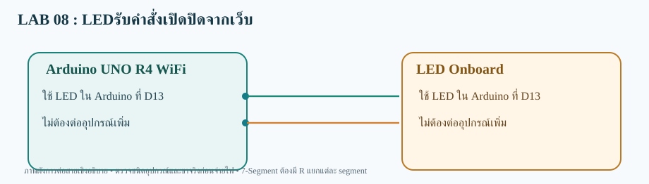

# LAB 08 — LEDรับคำสั่งเปิดปิดจากเว็บ

**รับคำสั่งจากเว็บ (Subscribe)** · Arduino UNO R4 WiFi

## การต่อสาย
- ใช้ LED ใน Arduino ที่ D13
- ไม่ต้องต่ออุปกรณ์เพิ่ม

อุปกรณ์: LED Built-in ของ Arduino UNO R4 WiFi

## Topic
- **Publish:** ไม่ใช้
- **Subscribe:**  `68070131/applied/lab08/sub/set`
- **สถานะคำสั่ง:** ไม่ใช้

## วิธีทดสอบ
1. เปิด `LED_Control_sub.ino` ด้วย Arduino IDE (โฟลเดอร์ชื่อเดียวกับ Sketch)
2. เลือก **Arduino UNO R4 WiFi** ติดตั้ง WiFiS3 และ MQTT (256dpi)
3. ต่อสายตามผัง เปิด Serial 115200; ตรวจ Wi-Fi/MQTT
4. Publish ข้อความ `ON` ไปที่ Topic /set
5. ผลที่คาดหวัง: **LED Built-in ติด; ส่ง OFF แล้วดับ**

> โค้ดต้องต่อกับ Broker ที่เข้าถึงได้ และต้องตรวจบนบอร์ดจริง ไม่ใช่ยืนยันว่าทดสอบฮาร์ดแวร์แล้ว
