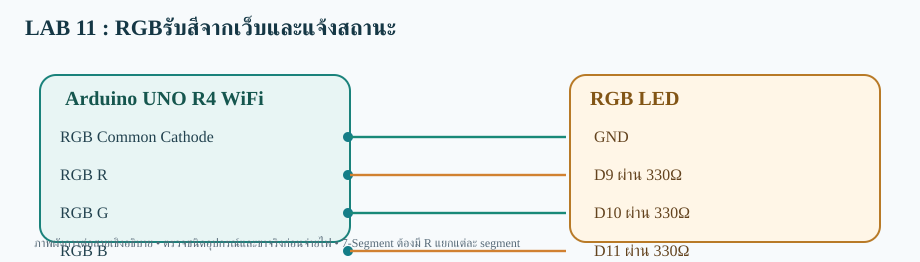

# LAB 11 — RGBรับสีจากเว็บและแจ้งสถานะ

**รับคำสั่งจากเว็บ (Subscribe)** · Arduino UNO R4 WiFi

## การต่อสาย
- RGB Common Cathode→GND
- RGB R→D9 ผ่าน 330Ω
- RGB G→D10 ผ่าน 330Ω
- RGB B→D11 ผ่าน 330Ω

อุปกรณ์: RGB LED แบบ Common Cathode + R 330Ω จำนวน 3 ตัว

## Topic
- **Publish:** ไม่ใช้
- **Subscribe:**  `68070131/applied/lab11/sub/set`
- **สถานะคำสั่ง:** ไม่ใช้

## วิธีทดสอบ
1. เปิด `RGB_Web_Control_sub.ino` ด้วย Arduino IDE (โฟลเดอร์ชื่อเดียวกับ Sketch)
2. เลือก **Arduino UNO R4 WiFi** ติดตั้ง WiFiS3 และ MQTT (256dpi)
3. ต่อสายตามผัง เปิด Serial 115200; ตรวจ Wi-Fi/MQTT
4. Publish ข้อความ `RED` ไปที่ Topic /set
5. ผลที่คาดหวัง: **ขา D9 เป็น HIGH; D10 และ D11 เป็น LOW**

> โค้ดต้องต่อกับ Broker ที่เข้าถึงได้ และต้องตรวจบนบอร์ดจริง ไม่ใช่ยืนยันว่าทดสอบฮาร์ดแวร์แล้ว
