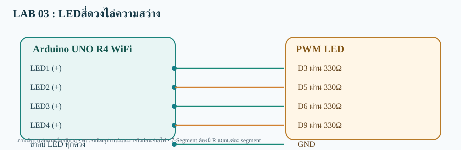

# LAB 03 — LEDสี่ดวงไล่ความสว่าง

**รับและส่งข้อมูลสองทาง** · Arduino UNO R4 WiFi

## การต่อสาย
- LED1 (+)→D3 ผ่าน 330Ω
- LED2 (+)→D5 ผ่าน 330Ω
- LED3 (+)→D6 ผ่าน 330Ω
- LED4 (+)→D9 ผ่าน 330Ω
- ขาลบ LED ทุกดวง→GND

อุปกรณ์: LED 4 ดวง + ตัวต้านทาน 330Ω สี่ตัว

## Topic
- **Publish:**  `68070131/applied/lab03/both/data`
- **Subscribe:**  `68070131/applied/lab03/both/set`
- **สถานะคำสั่ง:** `68070131/applied/lab03/both/state`

## วิธีทดสอบ
1. เปิด `FourLED_Fade_both.ino` ด้วย Arduino IDE (โฟลเดอร์ชื่อเดียวกับ Sketch)
2. เลือก **Arduino UNO R4 WiFi** ติดตั้ง WiFiS3 และ MQTT (256dpi)
3. ต่อสายตามผัง เปิด Serial 115200; ตรวจ Wi-Fi/MQTT
4. Publish ข้อความ `128` ไปที่ Topic /set
5. ผลที่คาดหวัง: **LED 4 ดวงสว่าง PWM ระดับ 128/255** และ Topic /state ตอบ OK:128

> โค้ดต้องต่อกับ Broker ที่เข้าถึงได้ และต้องตรวจบนบอร์ดจริง ไม่ใช่ยืนยันว่าทดสอบฮาร์ดแวร์แล้ว
