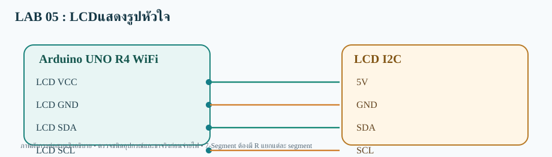

# LAB 05 — LCDแสดงรูปหัวใจ

**รับและส่งข้อมูลสองทาง** · Arduino UNO R4 WiFi

## การต่อสาย
- LCD VCC→5V
- LCD GND→GND
- LCD SDA→SDA
- LCD SCL→SCL

อุปกรณ์: LCD I2C 16×2 ที่อยู่ 0x27

## Topic
- **Publish:**  `68070131/applied/lab05/both/data`
- **Subscribe:**  `68070131/applied/lab05/both/set`
- **สถานะคำสั่ง:** `68070131/applied/lab05/both/state`

## วิธีทดสอบ
1. เปิด `LCD_Heart_both.ino` ด้วย Arduino IDE (โฟลเดอร์ชื่อเดียวกับ Sketch)
2. เลือก **Arduino UNO R4 WiFi** ติดตั้ง WiFiS3 และ MQTT (256dpi) และ LiquidCrystal I2C
3. ต่อสายตามผัง เปิด Serial 115200; ตรวจ Wi-Fi/MQTT
4. Publish ข้อความ `OFF` ไปที่ Topic /set
5. ผลที่คาดหวัง: **LCD ซ่อนรูปหัวใจ; ส่ง ON จะแสดงหัวใจอีกครั้ง** และ Topic /state ตอบ OK:OFF

> โค้ดต้องต่อกับ Broker ที่เข้าถึงได้ และต้องตรวจบนบอร์ดจริง ไม่ใช่ยืนยันว่าทดสอบฮาร์ดแวร์แล้ว
