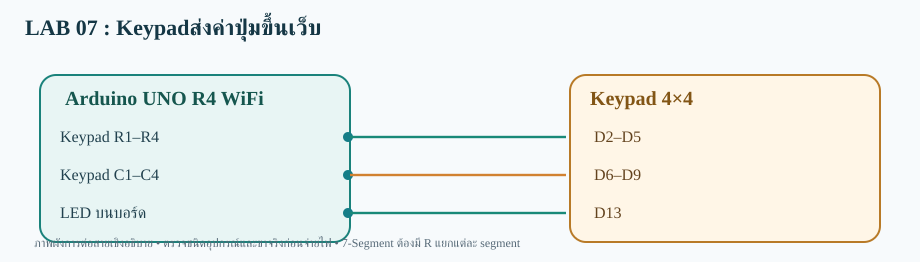

# LAB 07 — Keypadส่งค่าปุ่มขึ้นเว็บ

**รับและส่งข้อมูลสองทาง** · Arduino UNO R4 WiFi

## การต่อสาย
- Keypad R1–R4→D2–D5
- Keypad C1–C4→D6–D9
- LED บนบอร์ด→D13

อุปกรณ์: Keypad 4×4 และ LED บน Arduino

## Topic
- **Publish:**  `68070131/applied/lab07/both/data`
- **Subscribe:**  `68070131/applied/lab07/both/set`
- **สถานะคำสั่ง:** `68070131/applied/lab07/both/state`

## วิธีทดสอบ
1. เปิด `Keypad_Publisher_both.ino` ด้วย Arduino IDE (โฟลเดอร์ชื่อเดียวกับ Sketch)
2. เลือก **Arduino UNO R4 WiFi** ติดตั้ง WiFiS3 และ MQTT (256dpi)
3. ต่อสายตามผัง เปิด Serial 115200; ตรวจ Wi-Fi/MQTT
4. Publish ข้อความ `ON` ไปที่ Topic /set
5. ผลที่คาดหวัง: **เว็บสั่ง ON ให้ LED บอร์ดติด; เมื่อกด Keypad 'A' เว็บแสดง A** และ Topic /state ตอบ OK:ON

> โค้ดต้องต่อกับ Broker ที่เข้าถึงได้ และต้องตรวจบนบอร์ดจริง ไม่ใช่ยืนยันว่าทดสอบฮาร์ดแวร์แล้ว
