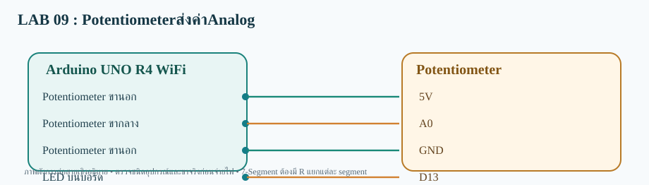

# LAB 09 — Potentiometerส่งค่าAnalog

**รับและส่งข้อมูลสองทาง** · Arduino UNO R4 WiFi

## การต่อสาย
- Potentiometer ขานอก→5V
- Potentiometer ขากลาง→A0
- Potentiometer ขานอก→GND
- LED บนบอร์ด→D13

อุปกรณ์: Potentiometer 10kΩ และ LED บนบอร์ด

## Topic
- **Publish:**  `68070131/applied/lab09/both/data`
- **Subscribe:**  `68070131/applied/lab09/both/set`
- **สถานะคำสั่ง:** `68070131/applied/lab09/both/state`

## วิธีทดสอบ
1. เปิด `Potentiometer_Send_both.ino` ด้วย Arduino IDE (โฟลเดอร์ชื่อเดียวกับ Sketch)
2. เลือก **Arduino UNO R4 WiFi** ติดตั้ง WiFiS3 และ MQTT (256dpi)
3. ต่อสายตามผัง เปิด Serial 115200; ตรวจ Wi-Fi/MQTT
4. Publish ข้อความ `75` ไปที่ Topic /set
5. ผลที่คาดหวัง: **ปรับ Potentiometer ได้ 75% เว็บแสดง 75; ตั้งเกณฑ์ 75 LED ติดเมื่อค่า≥75** และ Topic /state ตอบ OK:75

> โค้ดต้องต่อกับ Broker ที่เข้าถึงได้ และต้องตรวจบนบอร์ดจริง ไม่ใช่ยืนยันว่าทดสอบฮาร์ดแวร์แล้ว
