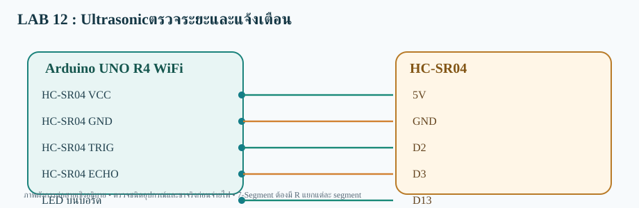

# LAB 12 — Ultrasonicตรวจระยะและแจ้งเตือน

**รับและส่งข้อมูลสองทาง** · Arduino UNO R4 WiFi

## การต่อสาย
- HC-SR04 VCC→5V
- HC-SR04 GND→GND
- HC-SR04 TRIG→D2
- HC-SR04 ECHO→D3
- LED บนบอร์ด→D13

อุปกรณ์: HC-SR04 + LED Built-in

## Topic
- **Publish:**  `68070131/applied/lab12/both/data`
- **Subscribe:**  `68070131/applied/lab12/both/set`
- **สถานะคำสั่ง:** `68070131/applied/lab12/both/state`

## วิธีทดสอบ
1. เปิด `Ultrasonic_Distance_both.ino` ด้วย Arduino IDE (โฟลเดอร์ชื่อเดียวกับ Sketch)
2. เลือก **Arduino UNO R4 WiFi** ติดตั้ง WiFiS3 และ MQTT (256dpi)
3. ต่อสายตามผัง เปิด Serial 115200; ตรวจ Wi-Fi/MQTT
4. Publish ข้อความ `25` ไปที่ Topic /set
5. ผลที่คาดหวัง: **ตั้งเกณฑ์ 25 ซม.; วัตถุอยู่ที่ 15 ซม. LED บนบอร์ดติด** และ Topic /state ตอบ OK:25

> โค้ดต้องต่อกับ Broker ที่เข้าถึงได้ และต้องตรวจบนบอร์ดจริง ไม่ใช่ยืนยันว่าทดสอบฮาร์ดแวร์แล้ว
